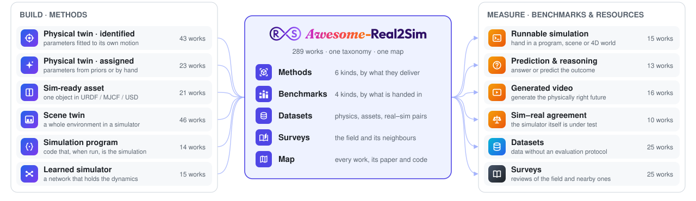
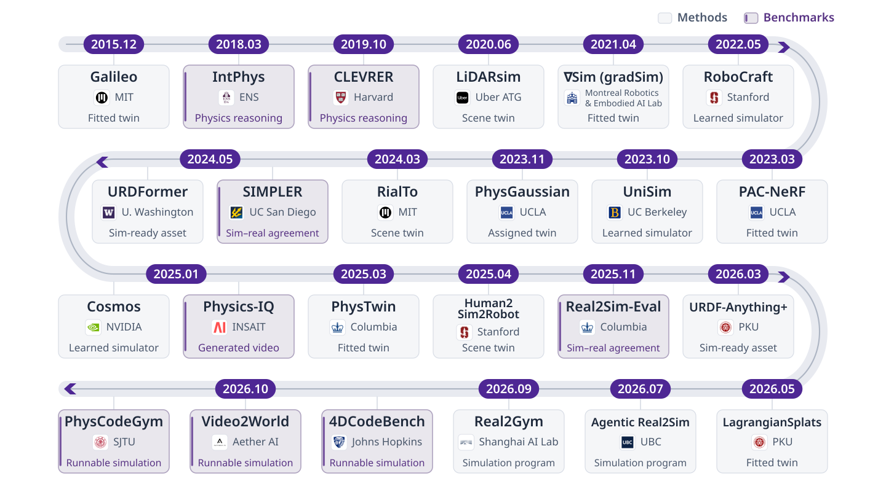
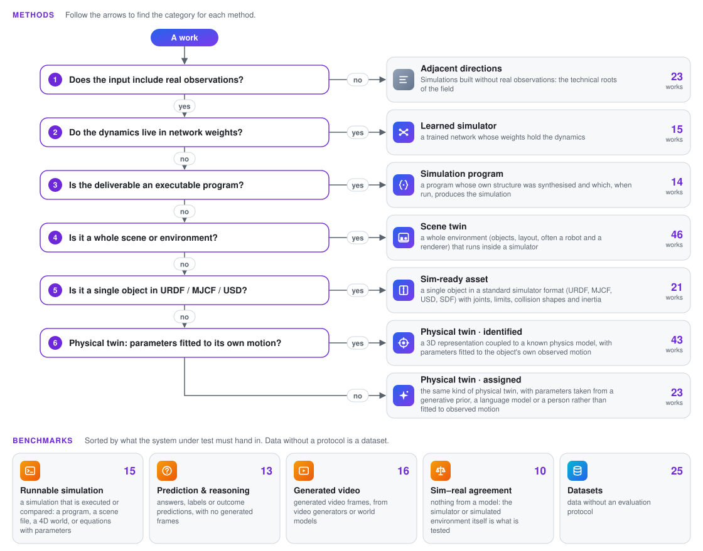
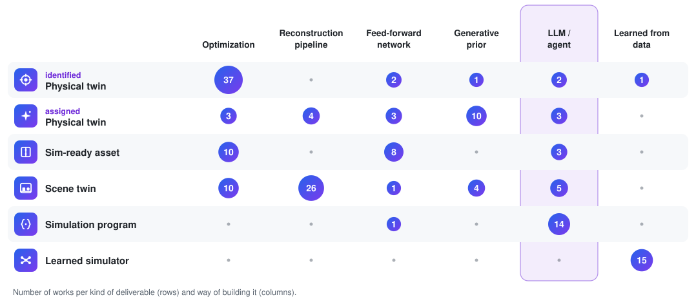
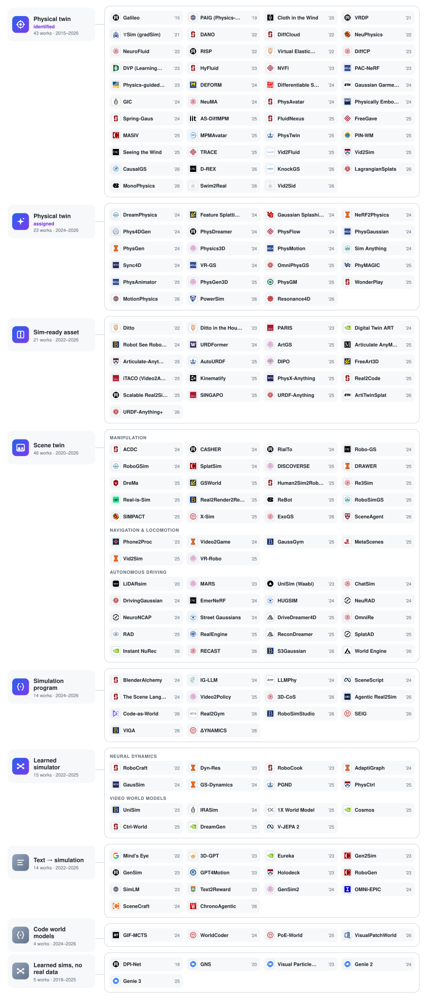
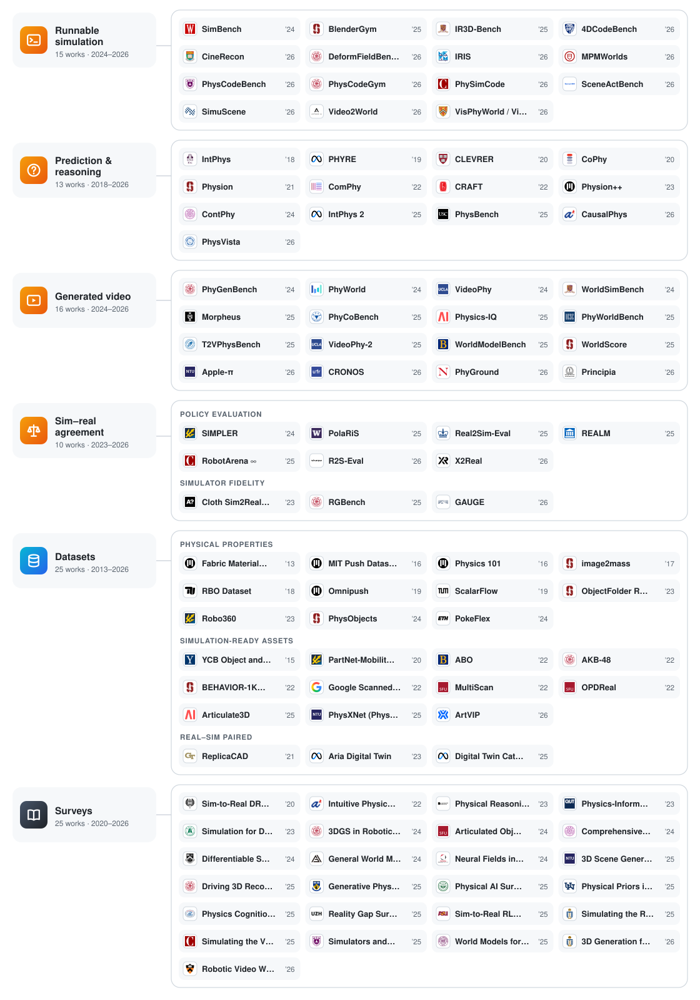
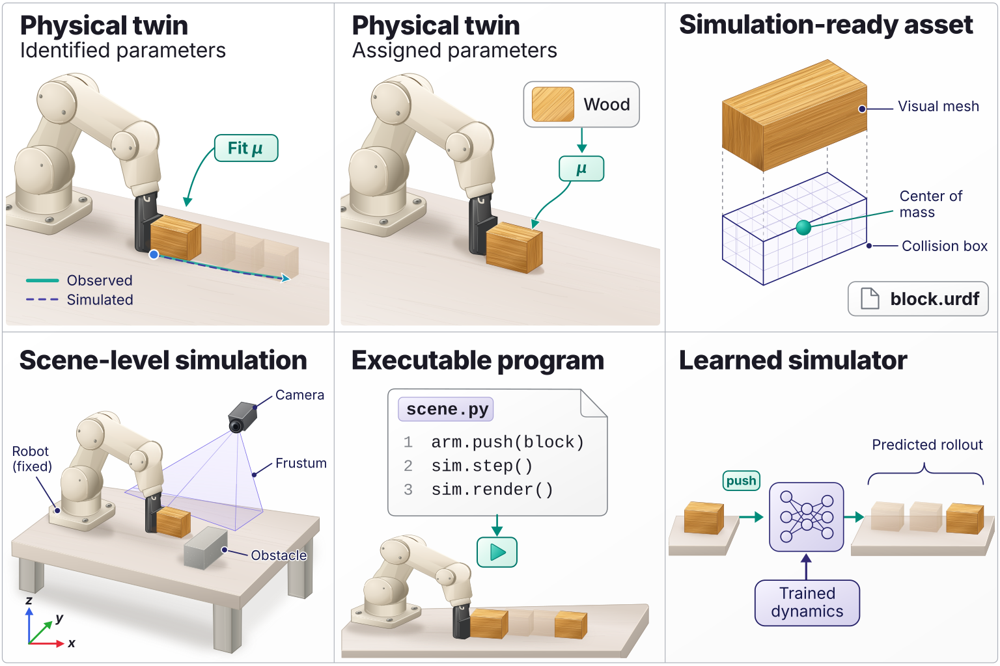
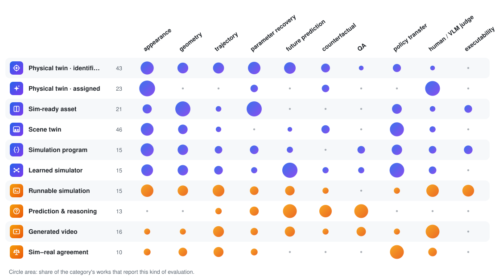

<!-- Generated by scripts/build.py from data/ and scripts/readme_template.md. Do not edit README.md by hand. -->

<div align="center">

<picture>
  <source media="(prefers-color-scheme: dark)" srcset="assets/logo-dark.svg">
  
</picture>

<h3>A curated map of real-to-simulation research</h3>

<p><b>What is built from the real world · how it is built · how it is measured</b></p>

<p>
🛣️&nbsp;<a href="#%EF%B8%8F-roadmap"><b>Roadmap</b></a> &nbsp;·&nbsp;
🧭&nbsp;<a href="#-taxonomy"><b>Taxonomy</b></a> &nbsp;·&nbsp;
🗺️&nbsp;<a href="#%EF%B8%8F-the-map"><b>Map</b></a> &nbsp;·&nbsp;
🧪&nbsp;<a href="#-methods"><b>Methods</b></a> &nbsp;·&nbsp;
📊&nbsp;<a href="#-benchmarks"><b>Benchmarks</b></a> &nbsp;·&nbsp;
📦&nbsp;<a href="#-datasets"><b>Datasets</b></a> &nbsp;·&nbsp;
📚&nbsp;<a href="#-surveys"><b>Surveys</b></a> &nbsp;·&nbsp;
📝&nbsp;<a href="#-citation"><b>Citation</b></a>
</p>

[](https://arxiv.org/abs/2611.34849)


[](https://real2simhub.github.io/assets/img/connect/wechat-group.jpg)

<!-- The Real2SimHub series: the hub, the platform and this list. -->
<table align="center">
  <tr>
    <td align="center"><a href="https://real2simhub.github.io/"><picture><source media="(prefers-color-scheme: dark)" srcset="assets/symbol-hub-dark.svg"></picture> <b>Real2SimHub</b></a></td>
    <td align="center"><a href="https://github.com/Real2SimHub/Real2SimLab"><picture><source media="(prefers-color-scheme: dark)" srcset="assets/symbol-lab-dark.svg"></picture> <b>Real2SimLab</b></a></td>
    <td align="center"><a href="https://github.com/Real2SimHub/Awesome-Real2Sim"><picture><source media="(prefers-color-scheme: dark)" srcset="assets/symbol-awesome-dark.svg"></picture> <b>Awesome&#8209;Real2Sim</b></a></td>
  </tr>
</table>

</div>

<picture>
  <source media="(prefers-color-scheme: dark)" srcset="assets/figures/overview-dark.svg">
  
</picture>

**Real2Sim** turns observations of the real world — videos, images, scans, interaction — into
something that can be **run**: a physical twin with fitted parameters, a simulation-ready asset,
a whole simulated scene, a simulation program, or a learned simulator. This list collects
290 works and sorts every one of them by **what it delivers**, so that each work has
exactly one place, and tags it with **how it is built**, the physics it covers and how it is evaluated.

## 🛣️ Roadmap

Key works along the way, from inferring physical properties with a physics engine to coding agents
that write whole simulations. Each card shows the first listed author’s first affiliation and what the
work delivers or asks for; a violet edge marks a benchmark. Months are those of the first arXiv version
(Galileo: of the conference).



<details>
<summary><b>Milestone papers</b> — the works on the roadmap, with links</summary>

| Year | Work | Category | Why it matters | Links |
|:-:|---|---|---|:-:|
| 2015 | [**Galileo**](https://proceedings.neurips.cc/paper/2015/hash/d09bf41544a3365a46c9077ebb5e35c3-Abstract.html) <sub>**NeurIPS&nbsp;2015** · MIT</sub> | Physical twin · identified | infers mass and friction from video | <a href="https://proceedings.neurips.cc/paper/2015/hash/d09bf41544a3365a46c9077ebb5e35c3-Abstract.html"></a> |
| 2018 | [**IntPhys**](https://intphys.com/) <sub>**IEEE&nbsp;TPAMI** · ENS</sub> | Prediction & reasoning | intuitive-physics benchmark | <a href="https://arxiv.org/abs/1803.07616"></a><br><a href="https://github.com/rronan/IntPhys-Baselines"></a><br><a href="https://intphys.com/"></a> |
| 2020 | [**CLEVRER**](http://clevrer.csail.mit.edu/) <sub>**ICLR&nbsp;2020** · Harvard University</sub> | Prediction & reasoning | causal reasoning on collisions | <a href="https://arxiv.org/abs/1910.01442"></a><br><a href="https://github.com/chuangg/CLEVRER"></a><br><a href="http://clevrer.csail.mit.edu/"></a> |
| 2020 | [**LiDARsim**](https://arxiv.org/abs/2006.09348) <sub>**CVPR&nbsp;2020** · Uber ATG</sub> | Scene twin | sensor sim from real scans | <a href="https://arxiv.org/abs/2006.09348"></a> |
| 2021 | [**∇Sim (gradSim)**](https://gradsim.github.io) <sub>**ICLR&nbsp;2021** · Montreal Robotics and Embodied AI Lab</sub> | Physical twin · identified | differentiable sim from video | <a href="https://arxiv.org/abs/2104.02646"></a><br><a href="https://github.com/gradsim/gradsim"></a><br><a href="https://gradsim.github.io"></a> |
| 2022 | [**RoboCraft**](http://hxu.rocks/robocraft/) <sub>**RSS&nbsp;2022** · Stanford University</sub> | Learned simulator | learned particle dynamics | <a href="https://arxiv.org/abs/2205.02909"></a><br><a href="https://github.com/hshi74/robocraft"></a><br><a href="http://hxu.rocks/robocraft/"></a> |
| 2023 | [**PAC-NeRF**](https://sites.google.com/view/PAC-NeRF) <sub>**ICLR&nbsp;2023** · UCLA</sub> | Physical twin · identified | NeRF + MPM system identification | <a href="https://arxiv.org/abs/2303.05512"></a><br><a href="https://github.com/xuan-li/PAC-NeRF"></a><br><a href="https://sites.google.com/view/PAC-NeRF"></a> |
| 2023 | [**UniSim**](https://universal-simulator.github.io/unisim/) <sub>**ICLR&nbsp;2024** · UC Berkeley</sub> | Learned simulator | learned interactive simulator | <a href="https://arxiv.org/abs/2310.06114"></a><br><a href="https://universal-simulator.github.io/unisim/"></a> |
| 2024 | [**PhysGaussian**](https://xpandora.github.io/PhysGaussian/) <sub>**CVPR&nbsp;2024** · UCLA</sub> | Physical twin · assigned | 3D Gaussians + MPM | <a href="https://arxiv.org/abs/2311.12198"></a><br><a href="https://github.com/XPandora/PhysGaussian"></a><br><a href="https://xpandora.github.io/PhysGaussian/"></a> |
| 2024 | [**RialTo**](https://real-to-sim-to-real.github.io/RialTo/) <sub>**RSS&nbsp;2024** · MIT</sub> | Scene twin | real-to-sim-to-real for robots | <a href="https://arxiv.org/abs/2403.03949"></a><br><a href="https://github.com/real-to-sim-to-real/RialToPolicyLearning"></a><br><a href="https://real-to-sim-to-real.github.io/RialTo/"></a> |
| 2024 | [**SIMPLER**](https://simpler-env.github.io) <sub>**CoRL&nbsp;2024** · UC San Diego</sub> | Sim–real agreement | does sim match the real robot? | <a href="https://arxiv.org/abs/2405.05941"></a><br><a href="https://github.com/simpler-env/SimplerEnv"></a><br><a href="https://simpler-env.github.io"></a> |
| 2024 | [**URDFormer**](https://urdformer.github.io) <sub>**RSS&nbsp;2024** · University of Washington</sub> | Sim-ready asset | images to articulated URDF | <a href="https://arxiv.org/abs/2405.11656"></a><br><a href="https://github.com/WEIRDLabUW/urdformer"></a><br><a href="https://urdformer.github.io"></a> |
| 2025 | [**Cosmos**](https://arxiv.org/abs/2501.03575) <sub>**arXiv&nbsp;2025** · NVIDIA</sub> | Learned simulator | world foundation models | <a href="https://arxiv.org/abs/2501.03575"></a><br><a href="https://github.com/nvidia-cosmos/cosmos-predict1"></a> |
| 2025 | [**Human2Sim2Robot**](https://human2sim2robot.github.io) <sub>**CoRL&nbsp;2025** · Stanford University</sub> | Scene twin | robot skills from one human video | <a href="https://arxiv.org/abs/2504.12609"></a><br><a href="https://github.com/tylerlum/human2sim2robot"></a><br><a href="https://human2sim2robot.github.io"></a> |
| 2025 | [**Physics-IQ**](https://physics-iq.github.io/) <sub>**WACV&nbsp;2026** · INSAIT</sub> | Generated video | do video models get physics? | <a href="https://arxiv.org/abs/2501.09038"></a><br><a href="https://github.com/google-deepmind/physics-IQ-benchmark"></a><br><a href="https://physics-iq.github.io/"></a> |
| 2025 | [**PhysTwin**](https://jianghanxiao.github.io/phystwin-web/) <sub>**ICCV&nbsp;2025** · Columbia University</sub> | Physical twin · identified | twins of deformable objects | <a href="https://arxiv.org/abs/2503.17973"></a><br><a href="https://github.com/Jianghanxiao/PhysTwin"></a><br><a href="https://jianghanxiao.github.io/phystwin-web/"></a> |
| 2025 | [**Real2Sim-Eval**](https://real2sim-eval.github.io/) <sub>**arXiv&nbsp;2025** · Columbia University</sub> | Sim–real agreement | policy evaluation in soft-body twins | <a href="https://arxiv.org/abs/2511.04665"></a><br><a href="https://github.com/kywind/real2sim-eval"></a><br><a href="https://real2sim-eval.github.io/"></a> |
| 2026 | [**4DCodeBench**](https://4dcodebench.com/) <sub>**arXiv&nbsp;2026** · Johns Hopkins University</sub> | Runnable simulation | coding agents write 4D worlds | <a href="https://arxiv.org/abs/2610.03715"></a><br><a href="https://github.com/4DCodeBench/4DCodeBench"></a><br><a href="https://4dcodebench.com/"></a> |
| 2026 | [**Agentic Real2Sim**](https://agentic-real2sim.github.io) <sub>**arXiv&nbsp;2026** · University of British Columbia</sub> | Simulation program | VLM agents build physics twins | <a href="https://arxiv.org/abs/2607.19190"></a><br><a href="https://github.com/agentic-real2sim/agentic_real2sim"></a><br><a href="https://agentic-real2sim.github.io"></a> |
| 2026 | [**LagrangianSplats**](https://arxiv.org/abs/2605.09299) <sub>**SIGGRAPH&nbsp;2026** · Peking University</sub> | Physical twin · identified | divergence-free fluids from video | <a href="https://arxiv.org/abs/2605.09299"></a><br><a href="https://github.com/taoningxiao/LagrangianSplats"></a> |
| 2026 | [**PhysCodeGym**](https://arxiv.org/abs/2610.17288) <sub>**arXiv&nbsp;2026** · Shanghai Jiao Tong University</sub> | Runnable simulation | coding agents rebuild scenes in Blender | <a href="https://arxiv.org/abs/2610.17288"></a><br><a href="https://github.com/ShaoShuai0605/PhysCodeGym"></a> |
| 2026 | [**Real2Gym**](https://real2gym.github.io/) <sub>**arXiv&nbsp;2026** · Shanghai AI Laboratory</sub> | Simulation program | videos to simulation gyms | <a href="https://arxiv.org/abs/2609.37089"></a><br><a href="https://github.com/real2gym/Real2Gym"></a><br><a href="https://real2gym.github.io/"></a> |
| 2026 | [**URDF-Anything+**](https://arxiv.org/abs/2603.14010) <sub>**arXiv&nbsp;2026** · Peking University</sub> | Sim-ready asset | one image to an articulated URDF | <a href="https://arxiv.org/abs/2603.14010"></a> |
| 2026 | [**Video2World**](https://aetherlabsai.github.io/Video2World) <sub>**arXiv&nbsp;2026** · Aether AI</sub> | Runnable simulation | agents simulate robot videos | <a href="https://arxiv.org/abs/2610.04432"></a><br><a href="https://github.com/AetherLabsAI/Video2World"></a><br><a href="https://aetherlabsai.github.io/Video2World"></a> |

</details>

## 📝 Citation

Awesome-Real2Sim is released with [Real2SimLab](https://github.com/Real2SimHub/Real2SimLab), a
unified platform for real-to-simulation, and both are described in one paper
([arXiv:2611.34849](https://arxiv.org/abs/2611.34849)). If this list helps
your work, please cite it:

```bibtex
@article{real2simlab2026,
  title   = {Real2SimLab: A Unified Platform for Real-to-Simulation Transfer},
  author  = {Zhang, Yongchang and Huang, Jie and Ni, Yunhe and Zhou, Ningyu and Zhao, Guangyu and Liu, Ruixun and Huang, Rui and Wu, Yidi and Zhang, TianZe and Jiang, Zixiang and Li, Xiang and Shen, Kevin and Zhong, Yiwu},
  journal = {arXiv preprint arXiv:2611.34849},
  year    = {2026}
}
```

## 📑 Contents

- [🛣️ Roadmap](#%EF%B8%8F-roadmap)
- [🧭 Taxonomy](#-taxonomy)
- [🗺️ The map](#%EF%B8%8F-the-map)
- [🧰 Simulators used](#-simulators-used)
- [🧪 Methods](#-methods)
  - [Physical Twins · Identified Parameters](#physical-twins--identified-parameters) <sub>43</sub>
  - [Physical Twins · Assigned Parameters](#physical-twins--assigned-parameters) <sub>23</sub>
  - [Simulation-Ready Assets](#simulation-ready-assets) <sub>21</sub>
  - [Scene-Level Simulations & Digital Twins](#scene-level-simulations--digital-twins) <sub>46</sub>
  - [Executable Simulation Programs](#executable-simulation-programs) <sub>15</sub>
  - [Learned Simulators](#learned-simulators) <sub>15</sub>
- [📊 Benchmarks](#-benchmarks)
  - [Deliver a Runnable Simulation](#deliver-a-runnable-simulation) <sub>15</sub>
  - [Predict or Answer](#predict-or-answer) <sub>13</sub>
  - [Generate the Future](#generate-the-future) <sub>16</sub>
  - [Does the Simulator Match Reality?](#does-the-simulator-match-reality) <sub>10</sub>
- [📦 Datasets](#-datasets)
- [📚 Surveys](#-surveys)
- [🔭 Adjacent directions](#-adjacent-directions)
  - [Simulations Generated from Text](#simulations-generated-from-text) <sub>14</sub>
  - [Code World Models](#code-world-models) <sub>4</sub>
  - [Learned Simulators without Real Data](#learned-simulators-without-real-data) <sub>5</sub>
- [📈 Evaluation landscape](#-evaluation-landscape)
- [🤝 Contributing](#-contributing)

## 🧭 Taxonomy

**Every work is sorted by what it delivers**, so each work has exactly one place. A method finds its
category by the questions below; a benchmark by what the system under test must hand in.

<picture>
  <source media="(prefers-color-scheme: dark)" srcset="assets/figures/taxonomy-dark.svg">
  
</picture>

Why the deliverable: every paper delivers one main thing, and the deliverable decides how a
simulation can be used and checked. Techniques change fast and often mix, so how a method is built
is a tag, not a category.

| Category | Delivers | Works |
|---|---|:-:|
| [Physical Twins · Identified Parameters](#physical-twins--identified-parameters) | a 3D representation coupled to a known physics model, with parameters fitted to the object's own observed motion | 43 |
| [Physical Twins · Assigned Parameters](#physical-twins--assigned-parameters) | the same kind of physical twin, with parameters taken from a generative prior, a language model or a person rather than fitted to observed motion | 23 |
| [Simulation-Ready Assets](#simulation-ready-assets) | a single object in a standard simulator format (URDF, MJCF, USD, SDF) with joints, limits, collision shapes and inertia | 21 |
| [Scene-Level Simulations & Digital Twins](#scene-level-simulations--digital-twins) | a whole environment (objects, layout, often a robot and a renderer) that runs inside a simulator | 46 |
| [Executable Simulation Programs](#executable-simulation-programs) | a program whose own structure was synthesised and which, when run, produces the simulation | 15 |
| [Learned Simulators](#learned-simulators) | a trained network whose weights hold the dynamics | 15 |
| [Deliver a Runnable Simulation](#deliver-a-runnable-simulation) | a simulation that is executed or compared: a program, a scene file, a 4D world, or equations with parameters | 15 |
| [Predict or Answer](#predict-or-answer) | answers, labels or outcome predictions, with no generated frames | 13 |
| [Generate the Future](#generate-the-future) | generated video frames, from video generators or world models | 16 |
| [Does the Simulator Match Reality?](#does-the-simulator-match-reality) | nothing from a model: the simulator or simulated environment itself is what is tested | 10 |
| [Datasets](#datasets) | data without an evaluation protocol | 25 |

**How each method is built** is a tag, one per method:

- **Optimization**: parameters or structure fitted by differentiable simulation, rendering or search.
- **Reconstruction pipeline**: multi-stage reconstruction, alignment and assembly, sometimes with a person in the loop.
- **Feed-forward network**: a trained network predicts the result in one pass.
- **Generative prior**: a video or 3D generative model supplies motion or parameters.
- **LLM / agent**: a language model or coding agent writes or chooses the result.
- **Learned from data**: the simulator is a network trained on recorded dynamics.

<picture>
  <source media="(prefers-color-scheme: dark)" srcset="assets/figures/builders-dark.svg">
  
</picture>

## 🗺️ The map

<picture>
  <source media="(prefers-color-scheme: dark)" srcset="assets/figures/map-methods-dark.svg">
  
</picture>

<picture>
  <source media="(prefers-color-scheme: dark)" srcset="assets/figures/map-benchmarks-dark.svg">
  
</picture>

Each icon identifies the first listed author’s first affiliation, or the issuing team for a group-authored release. Institution names also appear in the paper tables below.

## 🧰 Simulators used

The physics engines and solvers the works in this list build on, with how many works name each one.

| Simulator | Used by | What it simulates |
|---|:-:|---|
| [**Material Point Method (MPM)**](https://github.com/taichi-dev/taichi) | 27 | continuum solids, fluids and granular matter; often written in Taichi or Warp |
| [**MuJoCo**](https://github.com/google-deepmind/mujoco) | 12 | rigid and articulated bodies, robots |
| [**NVIDIA Isaac Sim / Isaac Lab**](https://github.com/isaac-sim/IsaacLab) | 12 | GPU robot simulation with photoreal rendering |
| [**PyBullet**](https://github.com/bulletphysics/bullet3) | 7 | rigid and articulated bodies |
| [**Blender**](https://www.blender.org) | 6 | scenes, rendering and its physics engines |
| [**SAPIEN / ManiSkill**](https://github.com/haosulab/ManiSkill) | 4 | articulated objects and manipulation |
| [**NVIDIA Warp**](https://github.com/NVIDIA/warp) | 1 | differentiable GPU simulation in Python |
| [**Drake**](https://github.com/RobotLocomotion/drake) | 1 | model-based robotics, contact |

## 🧪 Methods



### Physical Twins · Identified Parameters

> **Delivers:** a 3D representation coupled to a known physics model, with parameters fitted to the object's own observed motion.<br>
> Reconstruct an object or scene, couple it to a known physics model (MPM, spring–mass, rigid body, FEM, rods) and fit the physical parameters until simulated motion matches the observed motion. The result simulates *this* object under new forces.

<table>
<thead><tr><th width="34%">Work</th><th width="50%">Input → Output</th><th width="16%">Links</th></tr></thead>
<tbody>
<tr><td><a href="https://arxiv.org/abs/2605.10586"><b>CausalGS</b></a><br><sub>ICMR 2026 · Guilin University of Electronic Technology</sub></td><td>multi-view video → 3D Gaussians + physical parameters</td><td align="center"><a href="https://arxiv.org/abs/2605.10586"></a><br><a href="https://github.com/DustSettled/CausalGS"></a></td></tr>
<tr><td><a href="https://louhz.github.io/drex.github.io/"><b>D-REX</b></a><br><sub>ICLR 2026 · University of Southern California</sub></td><td>multi-view video, interaction → Gaussian-splat object twin + identified object mass in a differentiable engine</td><td align="center"><a href="https://arxiv.org/abs/2603.01151"></a><br><a href="https://github.com/louhz/D-rex"></a><br><a href="https://louhz.github.io/drex.github.io/"></a></td></tr>
<tr><td><a href="https://arxiv.org/abs/2608.27365"><b>KnockGS</b></a><br><sub>arXiv 2026 · Tuojing Intelligence</sub></td><td>multi-view video → 3D Gaussians + physical parameters</td><td align="center"><a href="https://arxiv.org/abs/2608.27365"></a><br><a href="https://github.com/TuojingAI/KnockGS"></a></td></tr>
<tr><td><a href="https://arxiv.org/abs/2605.09299"><b>LagrangianSplats</b></a><br><sub>SIGGRAPH 2026 · Peking University</sub></td><td>multi-view video → Lagrangian 3D Gaussians + divergence-free velocity field</td><td align="center"><a href="https://arxiv.org/abs/2605.09299"></a><br><a href="https://github.com/taoningxiao/LagrangianSplats"></a></td></tr>
<tr><td><a href="https://daniel03c1.github.io/MonoPhysics/"><b>MonoPhysics</b></a><br><sub>NeurIPS 2026 · UNC Chapel Hill</sub></td><td>monocular video → 3D Gaussians + physical parameters</td><td align="center"><a href="https://arxiv.org/abs/2605.30320"></a><br><a href="https://github.com/daniel03c1/MonoPhysics"></a><br><a href="https://daniel03c1.github.io/MonoPhysics/"></a></td></tr>
<tr><td><a href="https://swim2real.github.io"><b>Swim2Real</b></a><br><sub>RA-L 2026 · University of Warsaw</sub></td><td>monocular video, simulation state → calibrated 16-parameter soft-robot simulator</td><td align="center"><a href="https://arxiv.org/abs/2603.20827"></a><br><a href="https://github.com/kevinxqiu/swim2real"></a><br><a href="https://swim2real.github.io"></a></td></tr>
<tr><td><a href="https://arxiv.org/abs/2602.19359"><b>Vid2Sid</b></a><br><sub>arXiv 2026 · University of Warsaw</sub></td><td>monocular video, simulation state → calibrated simulator physics parameters with rationales</td><td align="center"><a href="https://arxiv.org/abs/2602.19359"></a></td></tr>
<tr><td><a href="https://as-diffmpm.github.io/"><b>AS-DiffMPM</b></a><br><sub>NeurIPS 2025 · Italian Institute of Technology</sub></td><td>multi-view video → 3D Gaussians + physical parameters</td><td align="center"><a href="https://arxiv.org/abs/2511.06846"></a><br><a href="https://github.com/FedericoVasile1/as-diffmpm"></a><br><a href="https://as-diffmpm.github.io/"></a></td></tr>
<tr><td><a href="https://yuegao.me/FluidNexus"><b>FluidNexus</b></a><br><sub>CVPR 2025 · Stanford University</sub></td><td>monocular video → 3D fluid particles/fields + physics simulation for prediction</td><td align="center"><a href="https://arxiv.org/abs/2503.04720"></a><br><a href="https://github.com/ueoo/FluidNexus"></a><br><a href="https://yuegao.me/FluidNexus"></a></td></tr>
<tr><td><a href="https://arxiv.org/abs/2506.07865"><b>FreeGave</b></a><br><sub>CVPR 2025 · The Hong Kong Polytechnic University</sub></td><td>multi-view video → 3D Gaussians + divergence-free Gaussian velocity field</td><td align="center"><a href="https://arxiv.org/abs/2506.07865"></a><br><a href="https://github.com/vLAR-group/FreeGave"></a></td></tr>
<tr><td><a href="https://arxiv.org/abs/2508.01112"><b>MASIV</b></a><br><sub>ICCV 2025 · Carnegie Mellon University</sub></td><td>multi-view video → 3D Gaussians + physical parameters — neural constitutive model</td><td align="center"><a href="https://arxiv.org/abs/2508.01112"></a><br><a href="https://github.com/yizhou42/MASIV"></a></td></tr>
<tr><td><a href="https://KAISTChangmin.github.io/MPMAvatar/"><b>MPMAvatar</b></a><br><sub>NeurIPS 2025 · KAIST</sub></td><td>multi-view video → 3D Gaussians + physical parameters — garment mesh</td><td align="center"><a href="https://arxiv.org/abs/2510.01619"></a><br><a href="https://github.com/KAISTChangmin/MPMAvatar"></a><br><a href="https://KAISTChangmin.github.io/MPMAvatar/"></a></td></tr>
<tr><td><a href="https://jianghanxiao.github.io/phystwin-web/"><b>PhysTwin</b></a><br><sub>ICCV 2025 · Columbia University</sub></td><td>multi-view video, RGB-D → spring-mass / particle model — with 3D Gaussians</td><td align="center"><a href="https://arxiv.org/abs/2503.17973"></a><br><a href="https://github.com/Jianghanxiao/PhysTwin"></a><br><a href="https://jianghanxiao.github.io/phystwin-web/"></a></td></tr>
<tr><td><a href="https://pinwm.github.io"><b>PIN-WM</b></a><br><sub>RSS 2025 · National University of Defense Technology</sub></td><td>images, actions → differentiable rigid-body world model with Gaussian Splatting rendering</td><td align="center"><a href="https://arxiv.org/abs/2504.16693"></a><br><a href="https://github.com/XuAdventurer/PIN-WM"></a><br><a href="https://pinwm.github.io"></a></td></tr>
<tr><td><a href="https://chaoren2357.github.io/seeingthewind/"><b>Seeing the Wind</b></a><br><sub>NeurIPS 2025 · University of Southern California</sub></td><td>monocular video → 3D Gaussians + physical parameters — plus force field</td><td align="center"><a href="https://arxiv.org/abs/2512.00762"></a><br><a href="https://chaoren2357.github.io/seeingthewind/"></a></td></tr>
<tr><td><a href="https://arxiv.org/abs/2508.09811"><b>TRACE</b></a><br><sub>ICCV 2025 · The Hong Kong Polytechnic University</sub></td><td>multi-view video → 3D Gaussians as rigid particles with learned translation/rotation dynamics parameters</td><td align="center"><a href="https://arxiv.org/abs/2508.09811"></a><br><a href="https://github.com/vLAR-group/TRACE"></a></td></tr>
<tr><td><a href="https://arxiv.org/abs/2503.00868"><b>Vid2Fluid</b></a><br><sub>IEEE TVCG · Tencent</sub></td><td>monocular video → 3D fluid asset + fitted fluid simulator parameters</td><td align="center"><a href="https://arxiv.org/abs/2503.00868"></a></td></tr>
<tr><td><a href="https://czzzzh.github.io/Vid2Sim"><b>Vid2Sim</b></a><br><sub>CVPR 2025 · University of Pennsylvania</sub></td><td>monocular video → 3D Gaussians + physical parameters — mesh-free reduced sim</td><td align="center"><a href="https://arxiv.org/abs/2506.06440"></a><br><a href="https://github.com/CzzzzH/Vid2Sim"></a><br><a href="https://czzzzh.github.io/Vid2Sim"></a></td></tr>
<tr><td><a href="https://roahmlab.github.io/DEFORM/"><b>DEFORM</b></a><br><sub>CoRL 2024 · University of Michigan</sub></td><td>RGB-D → spring-mass / particle model — discrete elastic rod</td><td align="center"><a href="https://arxiv.org/abs/2406.05931"></a><br><a href="https://github.com/roahmlab/DEFORM"></a><br><a href="https://roahmlab.github.io/DEFORM/"></a></td></tr>
<tr><td><a href="https://arxiv.org/abs/2411.00554"><b>Differentiable SysID for Elastoplastic Manipulation</b></a><br><sub>IJRR · Cardiff University</sub></td><td>RGB-D → NeRF/particles + physical parameters — point-cloud particles</td><td align="center"><a href="https://arxiv.org/abs/2411.00554"></a></td></tr>
<tr><td><a href="https://eth-ait.github.io/Gaussian-Garments"><b>Gaussian Garments</b></a><br><sub>3DV 2025 · ETH Zurich</sub></td><td>multi-view video → garment mesh + Gaussian texture + garment-specific fine-tuned GNN simulator</td><td align="center"><a href="https://arxiv.org/abs/2409.08189"></a><br><a href="https://github.com/eth-ait/Gaussian-Garments"></a><br><a href="https://eth-ait.github.io/Gaussian-Garments"></a></td></tr>
<tr><td><a href="https://jukgei.github.io/project/gic/"><b>GIC</b></a><br><sub>NeurIPS 2024 · HKUST</sub></td><td>multi-view video → 3D Gaussians + physical parameters</td><td align="center"><a href="https://arxiv.org/abs/2406.14927"></a><br><a href="https://github.com/Jukgei/gic"></a><br><a href="https://jukgei.github.io/project/gic/"></a></td></tr>
<tr><td><a href="https://arxiv.org/abs/2410.08257"><b>NeuMA</b></a><br><sub>NeurIPS 2024 · Shanghai Jiao Tong University</sub></td><td>multi-view video → 3D Gaussians + physical parameters — neural constitutive correction</td><td align="center"><a href="https://arxiv.org/abs/2410.08257"></a><br><a href="https://github.com/XJay18/NeuMA"></a></td></tr>
<tr><td><a href="https://qingqing-zhao.github.io/PhysAvatar"><b>PhysAvatar</b></a><br><sub>ECCV 2024 · Stanford University</sub></td><td>multi-view video → mesh + physical parameters — garment mesh + Gaussians</td><td align="center"><a href="https://arxiv.org/abs/2404.04421"></a><br><a href="https://github.com/y-zheng18/PhysAvatar"></a><br><a href="https://qingqing-zhao.github.io/PhysAvatar"></a></td></tr>
<tr><td><a href="https://embodied-gaussians.github.io/"><b>Physically Embodied Gaussian Splatting</b></a><br><sub>CoRL 2024 · Queensland University of Technology</sub></td><td>multi-view video → particles with physics (particle-based simulation) + attached 3D Gaussians</td><td align="center"><a href="https://arxiv.org/abs/2406.10788"></a><br><a href="https://github.com/rai-opensource/embodied_gaussians"></a><br><a href="https://embodied-gaussians.github.io/"></a></td></tr>
<tr><td><a href="https://zlicheng.com/spring_gaus/"><b>Spring-Gaus</b></a><br><sub>ECCV 2024 · Stanford University</sub></td><td>multi-view video → spring-mass / particle model — with 3D Gaussians</td><td align="center"><a href="https://arxiv.org/abs/2403.09434"></a><br><a href="https://github.com/Colmar-zlicheng/Spring-Gaus"></a><br><a href="https://zlicheng.com/spring_gaus/"></a></td></tr>
<tr><td><a href="https://sites.google.com/view/diffcp"><b>DiffCP</b></a><br><sub>arXiv 2023 · Shanghai Jiao Tong University</sub></td><td>RGB-D → spring-mass / particle model — cloth</td><td align="center"><a href="https://arxiv.org/abs/2311.05141"></a><br><a href="https://github.com/denzelzheng/diffcp"></a><br><a href="https://sites.google.com/view/diffcp"></a></td></tr>
<tr><td><a href="https://yitongdeng.github.io/vortex_learning_webpage/"><b>DVP (Learning Vortex Dynamics)</b></a><br><sub>ICLR 2023 · Dartmouth College</sub></td><td>monocular video → vortex particles + differentiable vortex dynamics model</td><td align="center"><a href="https://arxiv.org/abs/2301.11494"></a><br><a href="https://github.com/yitongdeng-projects/learning_vortex_dynamics_code"></a><br><a href="https://yitongdeng.github.io/vortex_learning_webpage/"></a></td></tr>
<tr><td><a href="https://kovenyu.com/HyFluid/"><b>HyFluid</b></a><br><sub>NeurIPS 2023 · Stanford University</sub></td><td>multi-view video → neural fluid density + divergence-free velocity fields</td><td align="center"><a href="https://arxiv.org/abs/2312.06561"></a><br><a href="https://github.com/y-zheng18/HyFluid"></a><br><a href="https://kovenyu.com/HyFluid/"></a></td></tr>
<tr><td><a href="https://arxiv.org/abs/2312.06398"><b>NVFi</b></a><br><sub>NeurIPS 2023 · The Hong Kong Polytechnic University</sub></td><td>multi-view video → keyframe neural geometry/appearance + physics-constrained velocity field</td><td align="center"><a href="https://arxiv.org/abs/2312.06398"></a><br><a href="https://github.com/vLAR-group/NVFi"></a></td></tr>
<tr><td><a href="https://sites.google.com/view/PAC-NeRF"><b>PAC-NeRF</b></a><br><sub>ICLR 2023 · UCLA</sub></td><td>multi-view video → NeRF/particles + physical parameters</td><td align="center"><a href="https://arxiv.org/abs/2303.05512"></a><br><a href="https://github.com/xuan-li/PAC-NeRF"></a><br><a href="https://sites.google.com/view/PAC-NeRF"></a></td></tr>
<tr><td><a href="https://arxiv.org/abs/2311.12796"><b>Physics-guided SfT</b></a><br><sub>arXiv 2023 · University of Bonn</sub></td><td>monocular video, 3D scan → mesh + physical parameters — cloth template</td><td align="center"><a href="https://arxiv.org/abs/2311.12796"></a><br><a href="https://github.com/vc-bonn/Physics-guided-Shape-from-Template"></a></td></tr>
<tr><td><a href="https://arxiv.org/abs/2210.09420"><b>DANO</b></a><br><sub>arXiv 2022 · Stanford University</sub></td><td>images → rigid-body scene + parameters — NeRF density + rigid dynamics</td><td align="center"><a href="https://arxiv.org/abs/2210.09420"></a></td></tr>
<tr><td><a href="https://diffcloud.github.io"><b>DiffCloud</b></a><br><sub>IROS 2022 · Stanford University</sub></td><td>RGB-D → cloth simulation parameters (mass, stiffness)</td><td align="center"><a href="https://arxiv.org/abs/2204.03139"></a><br><a href="https://github.com/priyasundaresan/diffcloud_real2sim"></a><br><a href="https://diffcloud.github.io"></a></td></tr>
<tr><td><a href="https://sites.google.com/view/neuphysics"><b>NeuPhysics</b></a><br><sub>NeurIPS 2022 · University of Maryland</sub></td><td>monocular video → SDF geometry + hexahedral mesh + elastic physics parameters</td><td align="center"><a href="https://arxiv.org/abs/2210.12352"></a><br><a href="https://github.com/gaoalexander/neuphysics"></a><br><a href="https://sites.google.com/view/neuphysics"></a></td></tr>
<tr><td><a href="https://syguan96.github.io/NeuroFluid/"><b>NeuroFluid</b></a><br><sub>ICML 2022 · Shanghai Jiao Tong University</sub></td><td>multi-view video → fluid particles + learned particle transition model</td><td align="center"><a href="https://arxiv.org/abs/2203.01762"></a><br><a href="https://github.com/syguan96/NeuroFluid"></a><br><a href="https://syguan96.github.io/NeuroFluid/"></a></td></tr>
<tr><td><a href="http://risp.csail.mit.edu"><b>RISP</b></a><br><sub>ICLR 2022 · MIT</sub></td><td>monocular video → rigid-body scene + parameters — known rigid/articulated/soft systems</td><td align="center"><a href="https://arxiv.org/abs/2205.05678"></a><br><a href="http://risp.csail.mit.edu"></a></td></tr>
<tr><td><a href="https://arxiv.org/abs/2201.04623"><b>Virtual Elastic Objects</b></a><br><sub>CVPR 2022 · UT Austin</sub></td><td>multi-view video → NeRF/particles + physical parameters</td><td align="center"><a href="https://arxiv.org/abs/2201.04623"></a></td></tr>
<tr><td><a href="https://arxiv.org/abs/2110.15358"><b>VRDP</b></a><br><sub>NeurIPS 2021 · MIT</sub></td><td>monocular video, text → object trajectories + physical parameters (mass, friction, restitution) in a differentiable simulator</td><td align="center"><a href="https://arxiv.org/abs/2110.15358"></a><br><a href="https://github.com/dingmyu/VRDP"></a></td></tr>
<tr><td><a href="https://gradsim.github.io"><b>∇Sim (gradSim)</b></a><br><sub>ICLR 2021 · Montreal Robotics and Embodied AI Lab</sub></td><td>monocular video → mesh + physical parameters</td><td align="center"><a href="https://arxiv.org/abs/2104.02646"></a><br><a href="https://github.com/gradsim/gradsim"></a><br><a href="https://gradsim.github.io"></a></td></tr>
<tr><td><a href="https://arxiv.org/abs/2003.05065"><b>Cloth in the Wind</b></a><br><sub>CVPR 2020 · University of Amsterdam</sub></td><td>monocular video → cloth material parameters + wind force for a cloth simulator</td><td align="center"><a href="https://arxiv.org/abs/2003.05065"></a></td></tr>
<tr><td><a href="https://arxiv.org/abs/1905.11169"><b>PAIG (Physics-as-Inverse-Graphics)</b></a><br><sub>ICLR 2020 · University of Edinburgh</sub></td><td>monocular video → object states + explicit physical parameters in a differentiable physics engine</td><td align="center"><a href="https://arxiv.org/abs/1905.11169"></a><br><a href="https://github.com/seuqaj114/paig"></a></td></tr>
<tr><td><a href="https://proceedings.neurips.cc/paper/2015/hash/d09bf41544a3365a46c9077ebb5e35c3-Abstract.html"><b>Galileo</b></a><br><sub>NeurIPS 2015 · MIT</sub></td><td>monocular video → rigid-body scene + parameters</td><td align="center"><a href="https://proceedings.neurips.cc/paper/2015/hash/d09bf41544a3365a46c9077ebb5e35c3-Abstract.html"></a></td></tr>
</tbody>
</table>

<details>
<summary><b>How each work does it</b></summary>

- **CausalGS** — An inverse-physics module infers initial velocities and material properties, which drive a differentiable simulator as physics regularization.
- **D-REX** — Gaussian splats give geometry; a differentiable physics engine optimizes mass so simulated motion matches observed robot-object interaction.
- **KnockGS** — Temporal response features from observed dynamics are mapped to material scales, which are written back into the simulator and evaluated on held-out interactions.
- **LagrangianSplats** — A divergence-free kernel velocity field advects Lagrangian 3D Gaussians, optimized with a sliding-window scheme against the input views.
- **MonoPhysics** — Scene re-parameterization, physics-aware geometry refinement and a differentiable position map couple 3DGS to a differentiable simulator without multi-view constraints.
- **Swim2Real** — VLM proposals give search directions over 16 parameters; a line search tests each and keeps updates that reduce tracked marker error.
- **Vid2Sid** — Foundation-model perception tracks the robot in video; a VLM-in-the-loop optimizer reads sim-real comparisons and outputs parameter updates with rationales.
- **AS-DiffMPM** — Adds differentiable collision handling to MPM so geometry, appearance and material parameters can be optimized end-to-end with Gaussian rendering.
- **FluidNexus** — A novel-view video synthesizer generates multi-view references, then a physics-integrated particle representation is optimized to them and rolled forward for prediction.
- **FreeGave** — A divergence-free module estimates per-Gaussian velocity, avoiding PINN losses, and is fitted to the videos for extrapolation.
- **MASIV** — Reconstructs dense continuum particle trajectories as geometric guidance, then trains a neural constitutive model inside differentiable MPM.
- **MPMAvatar** — Tracked garment meshes supervise optimization of density, stiffness and a rest-geometry term in a tailored anisotropic MPM; Gaussians render appearance.
- **PhysTwin** — Generative shape completion plus a two-stage optimization (zero-order for global parameters, then first-order dense spring stiffness) fits a spring-mass model.
- **PIN-WM** — Friction, restitution and other parameters are optimized through a differentiable simulator with a Gaussian Splatting rendering loss; perturbed digital cousins train robust RL policies.
- **Seeing the Wind** — An end-to-end differentiable inverse-graphics pipeline jointly optimizes object geometry, physical properties and a force representation by backpropagation.
- **TRACE** — Each Gaussian is treated as a rigid particle in space whose translation and rotation dynamics parameters are learned from the videos.
- **Vid2Fluid** — Generative 3DGS gives initial geometry, a physics-corrected velocity field is estimated from surface motion, and simulator parameters are optimized to reproduce the video.
- **Vid2Sim** — A generalizable network predicts initial geometry and material; a lightweight differentiable mesh-free (LBS) simulation then refines everything in minutes.
- **DEFORM** — Rod parameters and a residual network are trained on real trajectories through a differentiable DER simulator.
- **Differentiable SysID for Elastoplastic Manipulation** — Point-cloud distances between real and simulated material after interactions are minimized through a differentiable MPM simulator.
- **Gaussian Garments** — Mesh plus Gaussian texture is registered to the videos, and a pre-trained GNN cloth simulator is fine-tuned to replicate the garment's observed motion.
- **GIC** — Dynamic Gaussians are converted to continuum particles via coarse-to-fine filling; MPM parameters are optimized against Gaussian-derived shapes and masks.
- **NeuMA** — A residual neural material adaptor corrects classical constitutive laws inside differentiable MPM; Particle-GS renders particles for image-space supervision.
- **PhysAvatar** — Tracks garment meshes, optimizes cloth material parameters through a physics simulator, and uses physically based rendering for appearance.
- **Physically Embodied Gaussian Splatting** — Particles run in a particle-based physics system; differences between rendered Gaussians and observed images produce corrective forces.
- **Spring-Gaus** — Reconstructs static 3D Gaussians, anchors them to spring-mass points, and optimizes spring parameters through a differentiable simulator to match the video.
- **DiffCP** — Minimizes the geometric gap between observed point clouds and simulated cloth states by gradient descent through the simulator.
- **DVP (Learning Vortex Dynamics)** — A latent set of Lagrangian vortex particles is evolved by learnable vortex dynamics and optimized so advected images match the video.
- **HyFluid** — Physics losses enforce divergence-free velocity that transports density, with a hybrid base plus vortex velocity representation fitted to the videos.
- **NVFi** — A velocity field is trained with physics-informed (Navier-Stokes style) constraints together with a keyframe radiance field.
- **PAC-NeRF** — An Eulerian-Lagrangian NeRF is advected by a differentiable MPM; rendering losses jointly optimize initial geometry, velocity and physical parameters.
- **Physics-guided SfT** — A pre-trained neural surrogate replaces the classical simulator; rendering losses back-propagate to stretching, shearing and bending parameters.
- **DANO** — Contact geometry comes from the NeRF density field; a differentiable contact simulator optimizes mass and friction to match observed motion.
- **DiffCloud** — A differentiable cloth simulator and differentiable point-cloud rendering let gradients of a Chamfer loss update mass and stiffness.
- **NeuPhysics** — A time-invariant SDF plus deformation field is bridged to a differentiable mesh simulator whose parameters are fitted to the video.
- **NeuroFluid** — A particle transition model is trained end-to-end through a particle-driven neural renderer so rendered frames match the observed fluid video.
- **RISP** — A state predictor trained with domain randomization and a gradient-based regularizer maps frames to states; parameters are then optimized through differentiable simulation.
- **Virtual Elastic Objects** — Reconstructs a dynamic neural radiance field, then fits per-point material parameters with a differentiable physics simulator to match captured deformations.
- **VRDP** — Perception and concept learners recover objects; an impulse-based differentiable rigid-body simulator fits their physical parameters to observed trajectories.
- **∇Sim (gradSim)** — Gradients of an image-space loss flow through a differentiable renderer and simulator to update physical parameters, given known object meshes.
- **Cloth in the Wind** — A simulation is iteratively updated so a learned spectral embedding of simulated and real cloth motion becomes close.
- **PAIG (Physics-as-Inverse-Graphics)** — An encoder recovers object positions, a differentiable physics engine with learnable parameters rolls them forward, and a decoder renders frames back.
- **Galileo** — A Bullet-based generative model is fit to tracked trajectories with short MCMC runs; a deep network learns to invert it for fast property estimation.

</details>

<p align="right"><a href="#-contents">back to contents ↑</a></p>

### Physical Twins · Assigned Parameters

> **Delivers:** the same kind of physical twin, with parameters taken from a generative prior, a language model or a person rather than fitted to observed motion.<br>
> Couple a physics model to a reconstructed or generated 3D scene, but take the parameters from somewhere other than the object's own motion: a video-generation prior, a vision-language model, or a hand-set value. Mostly used for interactive 3D/4D content.

<table>
<thead><tr><th width="34%">Work</th><th width="50%">Input → Output</th><th width="16%">Links</th></tr></thead>
<tbody>
<tr><td><a href="https://wangmiaowei.github.io/MotionPhysics.github.io/"><b>MotionPhysics</b></a><br><sub>AAAI 2026 · University of Edinburgh</sub></td><td>3D scan, text → 3D Gaussians + physical parameters</td><td align="center"><a href="https://arxiv.org/abs/2601.00504"></a><br><a href="https://github.com/wangmiaowei/MotionPhysics"></a><br><a href="https://wangmiaowei.github.io/MotionPhysics.github.io/"></a></td></tr>
<tr><td><a href="https://power-sim.github.io"><b>PowerSim</b></a><br><sub>arXiv 2026 · Johns Hopkins University</sub></td><td>images → 3D Gaussians + physical parameters — PowerFoam primitives</td><td align="center"><a href="https://arxiv.org/abs/2609.38153"></a><br><a href="https://github.com/nttung1110/PowerSim"></a><br><a href="https://power-sim.github.io"></a></td></tr>
<tr><td><a href="https://arxiv.org/abs/2604.01994"><b>Resonance4D</b></a><br><sub>arXiv 2026 · Xidian University</sub></td><td>images, text → 3D Gaussians + physical parameters — part-level</td><td align="center"><a href="https://arxiv.org/abs/2604.01994"></a></td></tr>
<tr><td><a href="https://wgsxm.github.io/projects/omniphysgs/"><b>OmniPhysGS</b></a><br><sub>ICLR 2025 · Peking University</sub></td><td>images, text → 3D Gaussians + physical parameters — per-Gaussian constitutive model</td><td align="center"><a href="https://arxiv.org/abs/2501.18982"></a><br><a href="https://github.com/wgsxm/OmniPhysGS"></a><br><a href="https://wgsxm.github.io/projects/omniphysgs/"></a></td></tr>
<tr><td><a href="https://arxiv.org/abs/2505.16456"><b>PhyMAGIC</b></a><br><sub>ECCV 2026 · University of Nevada, Reno</sub></td><td>single image, text → 3D Gaussians + physical parameters</td><td align="center"><a href="https://arxiv.org/abs/2505.16456"></a></td></tr>
<tr><td><a href="https://arxiv.org/abs/2501.16550"><b>PhysAnimator</b></a><br><sub>CVPR 2025 · UCLA</sub></td><td>single image, text → 4D video / animation — 2D cartoon</td><td align="center"><a href="https://arxiv.org/abs/2501.16550"></a></td></tr>
<tr><td><a href="https://by-luckk.github.io/PhysGen3D"><b>PhysGen3D</b></a><br><sub>CVPR 2025 · Tsinghua University</sub></td><td>single image → 4D video / animation — 3D scene with physical parameters</td><td align="center"><a href="https://arxiv.org/abs/2503.20746"></a><br><a href="https://github.com/by-luckk/PhysGen3D"></a><br><a href="https://by-luckk.github.io/PhysGen3D"></a></td></tr>
<tr><td><a href="https://arxiv.org/abs/2508.13911"><b>PhysGM</b></a><br><sub>CVPR 2026 · Beijing Institute of Technology</sub></td><td>single image → 3D Gaussians + physical parameters</td><td align="center"><a href="https://arxiv.org/abs/2508.13911"></a><br><a href="https://github.com/Hihixiaolv/PhysGM"></a></td></tr>
<tr><td><a href="https://kyleleey.github.io/WonderPlay/"><b>WonderPlay</b></a><br><sub>ICCV 2025 · Stanford University</sub></td><td>single image → 4D video / animation — dynamic 3D scene</td><td align="center"><a href="https://arxiv.org/abs/2505.18151"></a><br><a href="https://github.com/kyleleey/WonderPlay"></a><br><a href="https://kyleleey.github.io/WonderPlay/"></a></td></tr>
<tr><td><a href="https://arxiv.org/abs/2406.01476"><b>DreamPhysics</b></a><br><sub>AAAI 2025 · Harbin Institute of Technology</sub></td><td>images, text → 3D Gaussians + physical parameters</td><td align="center"><a href="https://arxiv.org/abs/2406.01476"></a><br><a href="https://github.com/tyhuang0428/DreamPhysics"></a></td></tr>
<tr><td><a href="https://feature-splatting.github.io/"><b>Feature Splatting</b></a><br><sub>ECCV 2024 · UC San Diego</sub></td><td>images, text → 4D video / animation — semantic Gaussians</td><td align="center"><a href="https://arxiv.org/abs/2404.01223"></a><br><a href="https://github.com/vuer-ai/feature-splatting"></a><br><a href="https://feature-splatting.github.io/"></a></td></tr>
<tr><td><a href="https://arxiv.org/abs/2401.15318"><b>Gaussian Splashing</b></a><br><sub>arXiv 2024 · University of Utah</sub></td><td>images → 4D video / animation — Gaussians + PBD particles</td><td align="center"><a href="https://arxiv.org/abs/2401.15318"></a></td></tr>
<tr><td><a href="https://ajzhai.github.io/NeRF2Physics/"><b>NeRF2Physics</b></a><br><sub>CVPR 2024 · UIUC</sub></td><td>images → dense per-point physical properties (mass density, friction, hardness)</td><td align="center"><a href="https://arxiv.org/abs/2404.04242"></a><br><a href="https://github.com/ajzhai/NeRF2Physics"></a><br><a href="https://ajzhai.github.io/NeRF2Physics/"></a></td></tr>
<tr><td><a href="https://jiajinglin.github.io/Phys4DGen"><b>Phys4DGen</b></a><br><sub>ACM MM 2025 · Xiamen University</sub></td><td>single image, text → 3D Gaussians + physical parameters — multi-material</td><td align="center"><a href="https://arxiv.org/abs/2411.16800"></a><br><a href="https://github.com/JiajingLin/Phys4DGen"></a><br><a href="https://jiajinglin.github.io/Phys4DGen"></a></td></tr>
<tr><td><a href="https://physdreamer.github.io/"><b>PhysDreamer</b></a><br><sub>ECCV 2024 · MIT</sub></td><td>images → 3D Gaussians + physical parameters — material field</td><td align="center"><a href="https://arxiv.org/abs/2404.13026"></a><br><a href="https://github.com/a1600012888/PhysDreamer"></a><br><a href="https://physdreamer.github.io/"></a></td></tr>
<tr><td><a href="https://zhuomanliu.github.io/PhysFlow/"><b>PhysFlow</b></a><br><sub>CVPR 2025 · The Hong Kong Polytechnic University</sub></td><td>images, text → 3D Gaussians + physical parameters</td><td align="center"><a href="https://arxiv.org/abs/2411.14423"></a><br><a href="https://github.com/zhuomanliu/PhysFlow"></a><br><a href="https://zhuomanliu.github.io/PhysFlow/"></a></td></tr>
<tr><td><a href="https://xpandora.github.io/PhysGaussian/"><b>PhysGaussian</b></a><br><sub>CVPR 2024 · UCLA</sub></td><td>images → 4D video / animation — 3D Gaussians as MPM particles</td><td align="center"><a href="https://arxiv.org/abs/2311.12198"></a><br><a href="https://github.com/XPandora/PhysGaussian"></a><br><a href="https://xpandora.github.io/PhysGaussian/"></a></td></tr>
<tr><td><a href="https://stevenlsw.github.io/physgen/"><b>PhysGen</b></a><br><sub>ECCV 2024 · UIUC</sub></td><td>single image → 4D video / animation — 2D rigid-body scene</td><td align="center"><a href="https://arxiv.org/abs/2409.18964"></a><br><a href="https://github.com/stevenlsw/physgen"></a><br><a href="https://stevenlsw.github.io/physgen/"></a></td></tr>
<tr><td><a href="https://liuff19.github.io/Physics3D"><b>Physics3D</b></a><br><sub>arXiv 2024 · Tsinghua University</sub></td><td>images, text → 3D Gaussians + physical parameters — elastic + viscous</td><td align="center"><a href="https://arxiv.org/abs/2406.04338"></a><br><a href="https://github.com/THU-SI/Physics3D"></a><br><a href="https://liuff19.github.io/Physics3D"></a></td></tr>
<tr><td><a href="https://supertan0204.github.io/physmotion_website/"><b>PhysMotion</b></a><br><sub>arXiv 2024 · UCLA</sub></td><td>single image → 4D video / animation</td><td align="center"><a href="https://arxiv.org/abs/2411.17189"></a><br><a href="https://supertan0204.github.io/physmotion_website/"></a></td></tr>
<tr><td><a href="https://arxiv.org/abs/2411.12789"><b>Sim Anything</b></a><br><sub>ICCV 2025 · Wuhan University</sub></td><td>images → 3D Gaussians + physical parameters — material distribution</td><td align="center"><a href="https://arxiv.org/abs/2411.12789"></a></td></tr>
<tr><td><a href="https://sync4dphys.github.io/"><b>Sync4D</b></a><br><sub>arXiv 2024 · Nanyang Technological University</sub></td><td>monocular video, 3D scan → 4D video / animation — generated 3D Gaussians</td><td align="center"><a href="https://arxiv.org/abs/2405.16849"></a><br><a href="https://sync4dphys.github.io/"></a></td></tr>
<tr><td><a href="https://yingjiang96.github.io/VR-GS/"><b>VR-GS</b></a><br><sub>SIGGRAPH 2024 · UCLA</sub></td><td>images → 4D video / animation — interactive Gaussians</td><td align="center"><a href="https://arxiv.org/abs/2401.16663"></a><br><a href="https://yingjiang96.github.io/VR-GS/"></a></td></tr>
</tbody>
</table>

<details>
<summary><b>How each work does it</b></summary>

- **MotionPhysics** — An MLLM proposes bounded material values; a learnable motion-distillation loss extracts motion priors from video diffusion to refine them through differentiable simulation.
- **PowerSim** — Each power-diagram primitive maps to MPM-tracked quantities, giving differentiable dynamics and rendering without an auxiliary representation.
- **Resonance4D** — Text-prompted segmentation splits Gaussians into parts; full material parameters are optimized with structural and spectral motion-consistency losses.
- **OmniPhysGS** — A physics-guided network predicts strain/stress per Gaussian from expert constitutive models; MPM rollouts are rendered and optimized with video diffusion guidance.
- **PhyMAGIC** — Image-to-video diffusion and confidence-guided LLM reasoning propose properties; a differentiable MPM on 3D Gaussians refines them iteratively.
- **PhysAnimator** — Segments the drawing into deformable meshes, simulates them under user forces, and uses sketch-guided video diffusion to render final frames.
- **PhysGen3D** — Image-to-3D, VLM-estimated physical properties and MPM simulation are combined with physically based rendering to produce videos.
- **PhysGM** — A large model jointly predicts Gaussians and material parameters in one forward pass, then simulates them with MPM.
- **WonderPlay** — A coarse physics simulation produces 3D dynamics that condition a video generator; the generated video then refines the 3D scene in a closed loop.
- **DreamPhysics** — Motion-aware score distillation from a video diffusion model supervises material parameters in a differentiable MPM.
- **Feature Splatting** — Foundation-model features are splatted into Gaussians; text-selected parts receive material settings and are simulated with MPM.
- **Gaussian Splashing** — Gaussians become PBD particles for solids and fluids; normals and specular terms are added for realistic fluid rendering.
- **NeRF2Physics** — Multi-view images build a CLIP-embedded point cloud; LLM-suggested materials and value ranges are assigned by zero-shot kernel regression.
- **Phys4DGen** — Segments the 3D object into material parts, infers material types and properties with foundation models, and simulates with MPM.
- **PhysDreamer** — A video generation model produces plausible motion of the object; a differentiable MPM optimizes the Young's modulus field and initial velocity to match it.
- **PhysFlow** — MLLM queries give initial materials; a differentiable MPM is refined so rendered optical flow matches flow from video-diffusion-generated clips.
- **PhysGaussian** — Gaussian kernels carry MPM state and deform with the simulated deformation gradient; internal filling and anisotropy regularization stabilize results.
- **PhysGen** — Perception estimates object geometry, materials and physical parameters from the image; a rigid-body simulator rolls out motion; diffusion-based rendering refines frames.
- **Physics3D** — A viscoelastic MPM with learnable parameters is rendered and optimized with score distillation from a video diffusion model.
- **PhysMotion** — Single-image 3D reconstruction yields Gaussians; differentiable MPM simulates them under input conditions; a diffusion model refines the coarse rendering.
- **Sim Anything** — MLLM-P3 predicts mean properties zero-shot, MPDP predicts their spatial distribution, and adaptive particle sampling feeds an efficient MPM.
- **Sync4D** — Blend-skinning shape reconstruction extracts reference motion; physical simulation drives matched target shapes, optimized with a displacement loss.
- **VR-GS** — Segments Gaussians into objects, embeds them in tetrahedral cages, and drives them with XPBD for real-time deformation and collision.

</details>

<p align="right"><a href="#-contents">back to contents ↑</a></p>

### Simulation-Ready Assets

> **Delivers:** a single object in a standard simulator format (URDF, MJCF, USD, SDF) with joints, limits, collision shapes and inertia.<br>
> Turn scans, images or interaction videos of a real object into an asset any physics engine can load: parts, joints, limits, collision geometry and inertia, most often for articulated objects.

<table>
<thead><tr><th width="34%">Work</th><th width="50%">Input → Output</th><th width="16%">Links</th></tr></thead>
<tbody>
<tr><td><a href="https://arxiv.org/abs/2606.24628"><b>ArtiTwinSplat</b></a><br><sub>ICRA 2026 Workshop · ETH Zurich</sub></td><td>RGB-D, monocular video → articulated asset (URDF/MJCF) — Gaussian-splat parts + joint kinematics</td><td align="center"><a href="https://arxiv.org/abs/2606.24628"></a></td></tr>
<tr><td><a href="https://arxiv.org/abs/2603.14010"><b>URDF-Anything+</b></a><br><sub>arXiv 2026 · Peking University</sub></td><td>single image → articulated asset (URDF/MJCF)</td><td align="center"><a href="https://arxiv.org/abs/2603.14010"></a></td></tr>
<tr><td><a href="https://articulate-gs.github.io"><b>ArtGS</b></a><br><sub>ICLR 2025 · Tsinghua University</sub></td><td>multi-view video, images → articulated asset (URDF/MJCF) — Gaussian parts + part meshes + joints</td><td align="center"><a href="https://arxiv.org/abs/2502.19459"></a><br><a href="https://github.com/YuLiu-LY/ArtGS"></a><br><a href="https://articulate-gs.github.io"></a></td></tr>
<tr><td><a href="https://articulate-anymesh.github.io"><b>Articulate AnyMesh</b></a><br><sub>arXiv 2025 · UMass Amherst</sub></td><td>3D scan → articulated asset (URDF/MJCF)</td><td align="center"><a href="https://arxiv.org/abs/2502.02590"></a><br><a href="https://articulate-anymesh.github.io"></a></td></tr>
<tr><td><a href="https://articulate-anything.github.io"><b>Articulate-Anything</b></a><br><sub>ICLR 2025 · University of Pennsylvania</sub></td><td>text, single image, monocular video → articulated asset (URDF/MJCF) — URDF via generated code</td><td align="center"><a href="https://arxiv.org/abs/2410.13882"></a><br><a href="https://github.com/vlongle/articulate-anything"></a><br><a href="https://articulate-anything.github.io"></a></td></tr>
<tr><td><a href="https://jl6017.github.io/AutoURDF/"><b>AutoURDF</b></a><br><sub>CVPR 2025 · Columbia University</sub></td><td>3D scan, multi-view video → articulated asset (URDF/MJCF) — robot URDF</td><td align="center"><a href="https://arxiv.org/abs/2412.05507"></a><br><a href="https://github.com/jl6017/AutoURDF"></a><br><a href="https://jl6017.github.io/AutoURDF/"></a></td></tr>
<tr><td><a href="https://rq-wu.github.io/projects/DIPO"><b>DIPO</b></a><br><sub>NeurIPS 2025 · Nankai University</sub></td><td>images → articulated asset (URDF/MJCF)</td><td align="center"><a href="https://arxiv.org/abs/2505.20460"></a><br><a href="https://github.com/RQ-Wu/DIPO"></a><br><a href="https://rq-wu.github.io/projects/DIPO"></a></td></tr>
<tr><td><a href="https://czzzzh.github.io/FreeArt3D"><b>FreeArt3D</b></a><br><sub>SIGGRAPH Asia 2025 · UC San Diego</sub></td><td>images → articulated asset (URDF/MJCF) — textured part meshes + joints</td><td align="center"><a href="https://arxiv.org/abs/2510.25765"></a><br><a href="https://github.com/CzzzzH/FreeArt3D"></a><br><a href="https://czzzzh.github.io/FreeArt3D"></a></td></tr>
<tr><td><a href="https://3dlg-hcvc.github.io/video2articulation/"><b>iTACO (Video2Articulation)</b></a><br><sub>3DV 2026 · Simon Fraser University</sub></td><td>RGB-D, monocular video → articulated asset (URDF/MJCF)</td><td align="center"><a href="https://arxiv.org/abs/2506.08334"></a><br><a href="https://github.com/3dlg-hcvc/video2articulation"></a><br><a href="https://3dlg-hcvc.github.io/video2articulation/"></a></td></tr>
<tr><td><a href="https://sites.google.com/deemos.com/kinematify"><b>Kinematify</b></a><br><sub>ICRA 2026 · Deemos Tech</sub></td><td>single image, text → articulated asset (URDF/MJCF)</td><td align="center"><a href="https://arxiv.org/abs/2511.01294"></a><br><a href="https://sites.google.com/deemos.com/kinematify"></a></td></tr>
<tr><td><a href="https://physx-anything.github.io/"><b>PhysX-Anything</b></a><br><sub>CVPR 2026 · Nanyang Technological University</sub></td><td>single image → articulated asset (URDF/MJCF) — with physical attributes</td><td align="center"><a href="https://arxiv.org/abs/2511.13648"></a><br><a href="https://github.com/ziangcao0312/PhysX-Anything"></a><br><a href="https://physx-anything.github.io/"></a></td></tr>
<tr><td><a href="https://real2code.github.io"><b>Real2Code</b></a><br><sub>ICLR 2025 · Stanford University</sub></td><td>images → articulated asset (URDF/MJCF) — MJCF code</td><td align="center"><a href="https://arxiv.org/abs/2406.08474"></a><br><a href="https://github.com/MandiZhao/real2code"></a><br><a href="https://real2code.github.io"></a></td></tr>
<tr><td><a href="https://scalable-real2sim.github.io/"><b>Scalable Real2Sim</b></a><br><sub>IROS 2025 · MIT</sub></td><td>RGB-D, interaction → object mesh + physical properties — visual/collision geometry + inertial parameters</td><td align="center"><a href="https://arxiv.org/abs/2503.00370"></a><br><a href="https://github.com/nepfaff/scalable-real2sim"></a><br><a href="https://scalable-real2sim.github.io/"></a></td></tr>
<tr><td><a href="https://3dlg-hcvc.github.io/singapo"><b>SINGAPO</b></a><br><sub>ICLR 2025 · Simon Fraser University</sub></td><td>single image → articulated asset (URDF/MJCF)</td><td align="center"><a href="https://arxiv.org/abs/2410.16499"></a><br><a href="https://github.com/3dlg-hcvc/singapo"></a><br><a href="https://3dlg-hcvc.github.io/singapo"></a></td></tr>
<tr><td><a href="https://arxiv.org/abs/2511.00940"><b>URDF-Anything</b></a><br><sub>NeurIPS 2025 · Peking University</sub></td><td>3D scan, text → articulated asset (URDF/MJCF)</td><td align="center"><a href="https://arxiv.org/abs/2511.00940"></a></td></tr>
<tr><td><a href="https://nvlabs.github.io/DigitalTwinArt"><b>Digital Twin ART</b></a><br><sub>CVPR 2024 · NVIDIA</sub></td><td>RGB-D → articulated asset (URDF/MJCF) — multi-part meshes + joints</td><td align="center"><a href="https://arxiv.org/abs/2404.01440"></a><br><a href="https://github.com/NVlabs/DigitalTwinArt"></a><br><a href="https://nvlabs.github.io/DigitalTwinArt"></a></td></tr>
<tr><td><a href="https://robot-see-robot-do.github.io"><b>Robot See Robot Do (RSRD)</b></a><br><sub>CoRL 2024 · UC Berkeley</sub></td><td>images, monocular video → articulated asset (URDF/MJCF) — part-segmented Gaussian model with tracked part poses</td><td align="center"><a href="https://arxiv.org/abs/2409.18121"></a><br><a href="https://github.com/kerrj/rsrd"></a><br><a href="https://robot-see-robot-do.github.io"></a></td></tr>
<tr><td><a href="https://urdformer.github.io"><b>URDFormer</b></a><br><sub>RSS 2024 · University of Washington</sub></td><td>single image → articulated asset (URDF/MJCF) — objects and kitchen scenes</td><td align="center"><a href="https://arxiv.org/abs/2405.11656"></a><br><a href="https://github.com/WEIRDLabUW/urdformer"></a><br><a href="https://urdformer.github.io"></a></td></tr>
<tr><td><a href="https://ut-austin-rpl.github.io/HouseDitto/"><b>Ditto in the House</b></a><br><sub>ICRA 2023 · UT Austin</sub></td><td>3D scan, interaction → articulated asset (URDF/MJCF) — room-scale articulated objects</td><td align="center"><a href="https://arxiv.org/abs/2302.01295"></a><br><a href="https://github.com/UT-Austin-RPL/HouseDitto"></a><br><a href="https://ut-austin-rpl.github.io/HouseDitto/"></a></td></tr>
<tr><td><a href="https://3dlg-hcvc.github.io/paris/"><b>PARIS</b></a><br><sub>ICCV 2023 · Simon Fraser University</sub></td><td>images → articulated asset (URDF/MJCF) — part implicit surfaces + one joint</td><td align="center"><a href="https://arxiv.org/abs/2308.07391"></a><br><a href="https://github.com/3dlg-hcvc/paris"></a><br><a href="https://3dlg-hcvc.github.io/paris/"></a></td></tr>
<tr><td><a href="https://ut-austin-rpl.github.io/Ditto/"><b>Ditto</b></a><br><sub>CVPR 2022 · UT Austin</sub></td><td>3D scan, interaction → articulated asset (URDF/MJCF) — part meshes + joint parameters</td><td align="center"><a href="https://arxiv.org/abs/2202.08227"></a><br><a href="https://github.com/UT-Austin-RPL/Ditto"></a><br><a href="https://ut-austin-rpl.github.io/Ditto/"></a></td></tr>
</tbody>
</table>

<details>
<summary><b>How each work does it</b></summary>

- **ArtiTwinSplat** — Tracks motion in the RGB-D video to infer part structure and joint kinematics, then optimizes a part-wise 3D Gaussian Splatting model for real-time rendering and manipulation.
- **URDF-Anything+** — Each step generates one link's geometry and its joint parameters conditioned on the image and previous parts; a termination token decides the number of parts.
- **ArtGS** — Canonical 3D Gaussians with coarse-to-fine initialization are aligned across states, and a skinning-inspired part-dynamics module learns part assignment and joint motion.
- **Articulate AnyMesh** — VLM visual prompting segments functional parts and infers joint type and axis from geometric cues, then exports an articulated model.
- **Articulate-Anything** — Mesh retrieval picks parts; a VLM actor writes link and joint code, the result is simulated and rendered, and a VLM critic compares it to the input and requests fixes.
- **AutoURDF** — Clusters points in the first frame, registers clusters across frames to get 6-DoF transforms, then infers part segmentation, kinematic tree and joints and exports meshes plus URDF.
- **DIPO** — A dual-image diffusion model predicts part layout and joints, a chain-of-thought graph reasoner infers part connectivity, and training uses the LEGO-Art-expanded PM-X dataset.
- **FreeArt3D** — Uses a pretrained static 3D diffusion model (e.g. Trellis) as prior and extends score distillation to articulation, jointly optimizing part geometry and joint parameters per instance.
- **iTACO (Video2Articulation)** — A coarse stage estimates joint parameters and movable-part segmentation from the video; a gradient-based refinement fits them to a reconstructed surface point cloud.
- **Kinematify** — Generates a 3D mesh, searches the kinematic tree with MCTS under structural regularity objectives, and estimates revolute/prismatic joints from static geometry (DW-CAVL) before exporting URDF.
- **PhysX-Anything** — A VLM produces coarse geometry and physical/kinematic tokens; a controllable flow transformer refines geometry, and the result is exported as URDF/XML.
- **Real2Code** — DUSt3R and a part segmenter recover oriented bounding boxes per part; a fine-tuned CodeLlama predicts joints as executable MJCF code.
- **Scalable Real2Sim** — The robot regrasps each object for a camera to reconstruct visual and collision meshes, then executes excitation trajectories and fits mass, center of mass and inertia from joint torques.
- **SINGAPO** — GPT-4o infers the part connectivity graph; a DDPM transformer conditioned on DINOv2 features generates part boxes and joints; part meshes are retrieved from a library.
- **URDF-Anything** — An autoregressive 3D MLLM reads point-cloud and text tokens; a [SEG] token queries point features for part masks while the model outputs kinematic parameters.
- **Digital Twin ART** — Reconstructs each state as a neural implicit field, then optimizes part segmentation and joint parameters so that the two states are consistent.
- **Robot See Robot Do (RSRD)** — A GARField-segmented Gaussian splat with DINO feature fields is fit to the video by differentiable rendering (4D-DPM); the recovered part trajectories drive bimanual grasp and motion planning.
- **URDFormer** — Detected part boxes are fed to a transformer trained on paired data synthesized with controllable text-to-image generation, which predicts part types, joints and hierarchy as URDF.
- **Ditto in the House** — Affordance prediction proposes interaction points; the robot interacts and Ditto-style inference on before/after observations recovers each object's articulation, with the two stages refining each other.
- **PARIS** — Two NeRF-style part fields are optimized jointly with a rigid motion between the two states; the motion is converted to a revolute or prismatic joint.
- **Ditto** — A PointNet++/ConvONet encoder fuses the two observations into dense features; implicit decoders predict part occupancy, segmentation and per-point joint type, axis and state.

</details>

<p align="right"><a href="#-contents">back to contents ↑</a></p>

### Scene-Level Simulations & Digital Twins

> **Delivers:** a whole environment (objects, layout, often a robot and a renderer) that runs inside a simulator.<br>
> Rebuild an entire real environment — a tabletop, a room, a street — inside a simulator, often with Gaussian splatting for realistic sensors, so that robots or vehicles can be trained and evaluated in it.

#### Manipulation

<table>
<thead><tr><th width="34%">Work</th><th width="50%">Input → Output</th><th width="16%">Links</th></tr></thead>
<tbody>
<tr><td><a href="https://arxiv.org/abs/2601.18629"><b>ExoGS</b></a><br><sub>arXiv 2026 · Shanghai Jiao Tong University</sub></td><td>multi-view video, interaction → Gaussian-splat simulator scene — editable 4D robot/object/scene assets</td><td align="center"><a href="https://arxiv.org/abs/2601.18629"></a><br><a href="https://github.com/zaixiabalala/ExoGS"></a></td></tr>
<tr><td><a href="https://computationalrobotics.seas.harvard.edu/SceneAgent/"><b>SceneAgent</b></a><br><sub>CoRL 2026 (LBR) · Harvard University</sub></td><td>3D scan, multi-view video → interactive simulation environment with articulated and deformable objects</td><td align="center"><a href="https://arxiv.org/abs/2610.34745"></a><br><a href="https://computationalrobotics.seas.harvard.edu/SceneAgent/"></a></td></tr>
<tr><td><a href="https://air-discoverse.github.io"><b>DISCOVERSE</b></a><br><sub>IROS 2025 · Tsinghua University</sub></td><td>multi-view video, images, 3D scan → Gaussian-splat simulator scene</td><td align="center"><a href="https://arxiv.org/abs/2507.21981"></a><br><a href="https://github.com/TATP-233/DISCOVERSE"></a><br><a href="https://air-discoverse.github.io"></a></td></tr>
<tr><td><a href="https://xiahongchi.github.io/DRAWER/"><b>DRAWER</b></a><br><sub>CVPR 2025 · UIUC</sub></td><td>monocular video → simulation-ready scene — interactable articulated room</td><td align="center"><a href="https://arxiv.org/abs/2504.15278"></a><br><a href="https://github.com/xiahongchi/DRAWER"></a><br><a href="https://xiahongchi.github.io/DRAWER/"></a></td></tr>
<tr><td><a href="https://dreamtomanipulate.github.io"><b>DreMa</b></a><br><sub>ICLR 2025 · University of Padua</sub></td><td>multi-view video, images → Gaussian-splat simulator scene — object-centric compositional world model</td><td align="center"><a href="https://arxiv.org/abs/2412.14957"></a><br><a href="https://github.com/leobarcellona/drema_code"></a><br><a href="https://dreamtomanipulate.github.io"></a></td></tr>
<tr><td><a href="https://3dgsworld.github.io/"><b>GSWorld</b></a><br><sub>ICRA 2026 · UC San Diego</sub></td><td>multi-view video, images → Gaussian-splat simulator scene</td><td align="center"><a href="https://arxiv.org/abs/2510.20813"></a><br><a href="https://github.com/luccachiang/GSWorld"></a><br><a href="https://3dgsworld.github.io/"></a></td></tr>
<tr><td><a href="https://human2sim2robot.github.io"><b>Human2Sim2Robot</b></a><br><sub>CoRL 2025 · Stanford University</sub></td><td>RGB-D, monocular video → policy — dexterous RL in a real-to-sim scene from one human demo</td><td align="center"><a href="https://arxiv.org/abs/2504.12609"></a><br><a href="https://github.com/tylerlum/human2sim2robot"></a><br><a href="https://human2sim2robot.github.io"></a></td></tr>
<tr><td><a href="https://re3sim.github.io/"><b>Re3Sim</b></a><br><sub>ICRA 2026 · Shanghai Jiao Tong University</sub></td><td>multi-view video, images → Gaussian-splat simulator scene</td><td align="center"><a href="https://arxiv.org/abs/2502.08645"></a><br><a href="https://github.com/InternRobotics/Re3Sim"></a><br><a href="https://re3sim.github.io/"></a></td></tr>
<tr><td><a href="https://real-is-sim.github.io"><b>Real-is-Sim</b></a><br><sub>ICRA 2026 · RAI Institute</sub></td><td>multi-view video → simulation-ready scene — continuously synchronized dynamic digital twin</td><td align="center"><a href="https://arxiv.org/abs/2504.03597"></a><br><a href="https://real-is-sim.github.io"></a></td></tr>
<tr><td><a href="https://real2render2real.com"><b>Real2Render2Real (R2R2R)</b></a><br><sub>CoRL 2025 · UC Berkeley</sub></td><td>multi-view video, monocular video → Gaussian-splat simulator scene — kinematic rendering of object trajectories, no dynamics</td><td align="center"><a href="https://arxiv.org/abs/2505.09601"></a><br><a href="https://github.com/uynitsuj/real2render2real"></a><br><a href="https://real2render2real.com"></a></td></tr>
<tr><td><a href="https://yuffish.github.io/rebot/"><b>ReBot</b></a><br><sub>IROS 2025 · UNC Chapel Hill</sub></td><td>monocular video → policy — training videos synthesized by sim replay over inpainted real backgrounds</td><td align="center"><a href="https://arxiv.org/abs/2503.14526"></a><br><a href="https://github.com/yuffish/rebot"></a><br><a href="https://yuffish.github.io/rebot/"></a></td></tr>
<tr><td><a href="https://arxiv.org/abs/2510.10637"><b>RoboSimGS</b></a><br><sub>arXiv 2025 · Wuhan University</sub></td><td>multi-view video, images → Gaussian-splat simulator scene — with MLLM-inferred physical properties</td><td align="center"><a href="https://arxiv.org/abs/2510.10637"></a></td></tr>
<tr><td><a href="https://simpact-bot.github.io"><b>SIMPACT</b></a><br><sub>CVPR 2026 · University of Maryland</sub></td><td>RGB-D, single image, text → physics simulation of the observed scene used for VLM action planning</td><td align="center"><a href="https://arxiv.org/abs/2512.05955"></a><br><a href="https://github.com/ShaoxiongYao/simpact"></a><br><a href="https://simpact-bot.github.io"></a></td></tr>
<tr><td><a href="https://portal-cornell.github.io/X-Sim/"><b>X-Sim</b></a><br><sub>CoRL 2025 · Cornell University</sub></td><td>RGB-D, monocular video → policy — RL in photorealistic reconstruction driven by object motion from human video</td><td align="center"><a href="https://arxiv.org/abs/2505.07096"></a><br><a href="https://github.com/portal-cornell/X-Sim"></a><br><a href="https://portal-cornell.github.io/X-Sim/"></a></td></tr>
<tr><td><a href="https://digital-cousins.github.io"><b>ACDC</b></a><br><sub>CoRL 2024 · Stanford University</sub></td><td>single image → digital cousin scenes</td><td align="center"><a href="https://arxiv.org/abs/2410.07408"></a><br><a href="https://github.com/cremebrule/digital-cousins"></a><br><a href="https://digital-cousins.github.io"></a></td></tr>
<tr><td><a href="https://casher-robot-learning.github.io/CASHER/"><b>CASHER</b></a><br><sub>arXiv 2024 · MIT</sub></td><td>monocular video → policy — trained across crowdsourced scene twins</td><td align="center"><a href="https://arxiv.org/abs/2412.01770"></a><br><a href="https://casher-robot-learning.github.io/CASHER/"></a></td></tr>
<tr><td><a href="https://real-to-sim-to-real.github.io/RialTo/"><b>RialTo</b></a><br><sub>RSS 2024 · MIT</sub></td><td>monocular video, 3D scan → policy — trained in an articulated digital twin of the target scene</td><td align="center"><a href="https://arxiv.org/abs/2403.03949"></a><br><a href="https://github.com/real-to-sim-to-real/RialToPolicyLearning"></a><br><a href="https://real-to-sim-to-real.github.io/RialTo/"></a></td></tr>
<tr><td><a href="https://robostudioapp.com"><b>Robo-GS</b></a><br><sub>arXiv 2024 · University of Southern California</sub></td><td>multi-view video, images → Gaussian-splat simulator scene — robot arm + scene hybrid mesh/Gaussian asset</td><td align="center"><a href="https://arxiv.org/abs/2408.14873"></a><br><a href="https://robostudioapp.com"></a></td></tr>
<tr><td><a href="https://robogsim.github.io"><b>RoboGSim</b></a><br><sub>arXiv 2024 · Harbin Institute of Technology</sub></td><td>multi-view video, images → Gaussian-splat simulator scene</td><td align="center"><a href="https://arxiv.org/abs/2411.11839"></a><br><a href="https://robogsim.github.io"></a></td></tr>
<tr><td><a href="https://splatsim.github.io"><b>SplatSim</b></a><br><sub>ICRA 2025 · Carnegie Mellon University</sub></td><td>multi-view video, images → Gaussian-splat simulator scene</td><td align="center"><a href="https://arxiv.org/abs/2409.10161"></a><br><a href="https://github.com/qureshinomaan/SplatSim"></a><br><a href="https://splatsim.github.io"></a></td></tr>
</tbody>
</table>

#### Navigation & locomotion

<table>
<thead><tr><th width="34%">Work</th><th width="50%">Input → Output</th><th width="16%">Links</th></tr></thead>
<tbody>
<tr><td><a href="https://escontrela.me/gauss_gym/"><b>GaussGym</b></a><br><sub>arXiv 2025 · UC Berkeley</sub></td><td>monocular video, multi-view video → Gaussian-splat simulator scene — for visual locomotion</td><td align="center"><a href="https://arxiv.org/abs/2510.15352"></a><br><a href="https://github.com/escontra/gauss_gym"></a><br><a href="https://escontrela.me/gauss_gym/"></a></td></tr>
<tr><td><a href="https://meta-scenes.github.io"><b>MetaScenes</b></a><br><sub>CVPR 2025 · BIGAI</sub></td><td>3D scan → simulation-ready scene — asset-replaced replicas of real scans</td><td align="center"><a href="https://arxiv.org/abs/2505.02388"></a><br><a href="https://github.com/meta-scenes/MetaScenes"></a><br><a href="https://meta-scenes.github.io"></a></td></tr>
<tr><td><a href="https://metadriverse.github.io/vid2sim"><b>Vid2Sim</b></a><br><sub>CVPR 2025 · UIUC</sub></td><td>monocular video → Gaussian-splat simulator scene — for urban navigation</td><td align="center"><a href="https://arxiv.org/abs/2501.06693"></a><br><a href="https://github.com/Vid2Sim/Vid2Sim"></a><br><a href="https://metadriverse.github.io/vid2sim"></a></td></tr>
<tr><td><a href="https://vr-robo.github.io"><b>VR-Robo</b></a><br><sub>RA-L 2025 · Tsinghua University</sub></td><td>multi-view video, images → Gaussian-splat simulator scene — for legged robots</td><td align="center"><a href="https://arxiv.org/abs/2502.01536"></a><br><a href="https://github.com/zst1406217/VR-Robo"></a><br><a href="https://vr-robo.github.io"></a></td></tr>
<tr><td><a href="https://video2game.github.io/"><b>Video2Game</b></a><br><sub>CVPR 2024 · UIUC</sub></td><td>monocular video → browser-runnable interactive game environment (meshes, textures, rigid-body physics)</td><td align="center"><a href="https://arxiv.org/abs/2404.09833"></a><br><a href="https://github.com/video2game/video2game"></a><br><a href="https://video2game.github.io/"></a></td></tr>
<tr><td><a href="https://allenai.org/project/phone2proc"><b>Phone2Proc</b></a><br><sub>CVPR 2023 · Allen Institute for AI</sub></td><td>3D scan → digital cousin scenes — procedurally generated variants of a scanned room</td><td align="center"><a href="https://arxiv.org/abs/2212.04819"></a><br><a href="https://github.com/allenai/phone2proc"></a><br><a href="https://allenai.org/project/phone2proc"></a></td></tr>
</tbody>
</table>

#### Autonomous driving

<table>
<thead><tr><th width="34%">Work</th><th width="50%">Input → Output</th><th width="16%">Links</th></tr></thead>
<tbody>
<tr><td><a href="https://research.nvidia.com/labs/sil/projects/instant-nurec/"><b>Instant NuRec</b></a><br><sub>arXiv 2026 · NVIDIA</sub></td><td>multi-view video → simulatable layered 3DGS world (static, dynamic, sky, per-camera ISP) from a short multi-camera log</td><td align="center"><a href="https://arxiv.org/abs/2607.14203"></a><br><a href="https://github.com/NVIDIA/instant-nurec"></a><br><a href="https://research.nvidia.com/labs/sil/projects/instant-nurec/"></a></td></tr>
<tr><td><a href="https://zijunkr.github.io/RECAST/"><b>RECAST</b></a><br><sub>arXiv 2026 · Shanghai Jiao Tong University</sub></td><td>multi-view video, images → reconstructed driving scene with generated view-complete 3DGS vehicles for planner-in-the-loop simulation</td><td align="center"><a href="https://arxiv.org/abs/2609.31374"></a><br><a href="https://zijunkr.github.io/RECAST/"></a></td></tr>
<tr><td><a href="https://wzzheng.net/S3Gaussian"><b>S3Gaussian</b></a><br><sub>ICRA 2026 · UC Berkeley</sub></td><td>multi-view video, LiDAR → annotation-free 4D Gaussian street scene for driving simulation</td><td align="center"><a href="https://arxiv.org/abs/2405.20323"></a><br><a href="https://github.com/nnanhuang/S3Gaussian"></a><br><a href="https://wzzheng.net/S3Gaussian"></a></td></tr>
<tr><td><a href="https://opendrivelab.com/WorldEngine/"><b>World Engine</b></a><br><sub>arXiv 2026 · Archon Robotics</sub></td><td>multi-view video, LiDAR → interactive 3DGS environments of real failure scenarios with generated safety-critical behaviour variants</td><td align="center"><a href="https://arxiv.org/abs/2606.19836"></a><br><a href="https://github.com/OpenDriveLab/WorldEngine"></a><br><a href="https://opendrivelab.com/WorldEngine/"></a></td></tr>
<tr><td><a href="https://drivedreamer4d.github.io"><b>DriveDreamer4D</b></a><br><sub>CVPR 2025 · GigaAI</sub></td><td>multi-view video, LiDAR → 4DGS driving scene that renders novel ego trajectories (lane changes, speed changes)</td><td align="center"><a href="https://arxiv.org/abs/2410.13571"></a><br><a href="https://github.com/GigaAI-research/DriveDreamer4D"></a><br><a href="https://drivedreamer4d.github.io"></a></td></tr>
<tr><td><a href="https://ziyc.github.io/omnire/"><b>OmniRe</b></a><br><sub>ICLR 2025 · Shanghai Jiao Tong University</sub></td><td>multi-view video, LiDAR → 3DGS digital twin of urban scenes with vehicles, pedestrians and cyclists as controllable actors</td><td align="center"><a href="https://arxiv.org/abs/2408.16760"></a><br><a href="https://github.com/ziyc/drivestudio"></a><br><a href="https://ziyc.github.io/omnire/"></a></td></tr>
<tr><td><a href="https://arxiv.org/abs/2502.13144"><b>RAD</b></a><br><sub>NeurIPS 2025 · Huazhong University of Science and Technology</sub></td><td>multi-view video → large-scale 3DGS digital replicas of real driving clips used as RL training and evaluation environments</td><td align="center"><a href="https://arxiv.org/abs/2502.13144"></a><br><a href="https://github.com/hustvl/RAD"></a></td></tr>
<tr><td><a href="https://arxiv.org/abs/2505.16902"><b>RealEngine</b></a><br><sub>arXiv 2025 · Fudan University</sub></td><td>multi-view video, LiDAR → closed-loop multi-agent driving simulator with reconstructed backgrounds and recomposable traffic participants (camera + LiDAR)</td><td align="center"><a href="https://arxiv.org/abs/2505.16902"></a><br><a href="https://github.com/LogosIntelligenceLab/RealEngine"></a></td></tr>
<tr><td><a href="https://recondreamer.github.io"><b>ReconDreamer</b></a><br><sub>CVPR 2025 · GigaAI</sub></td><td>multi-view video, LiDAR → Gaussian driving scene that stays photo-realistic under large maneuvers (multi-lane shifts)</td><td align="center"><a href="https://arxiv.org/abs/2411.19548"></a><br><a href="https://github.com/GigaAI-research/ReconDreamer"></a><br><a href="https://recondreamer.github.io"></a></td></tr>
<tr><td><a href="https://arxiv.org/abs/2411.16816"><b>SplatAD</b></a><br><sub>CVPR 2025 · Zenseact</sub></td><td>multi-view video, LiDAR → real-time 3DGS sensor simulator for both cameras and LiDAR</td><td align="center"><a href="https://arxiv.org/abs/2411.16816"></a><br><a href="https://github.com/carlinds/splatad"></a></td></tr>
<tr><td><a href="https://arxiv.org/abs/2402.05746"><b>ChatSim</b></a><br><sub>CVPR 2024 · Shanghai Jiao Tong University</sub></td><td>multi-view video, text → language-editable photo-realistic multi-camera driving scene simulation with inserted 3D assets</td><td align="center"><a href="https://arxiv.org/abs/2402.05746"></a><br><a href="https://github.com/yifanlu0227/ChatSim"></a></td></tr>
<tr><td><a href="https://github.com/VDIGPKU/DrivingGaussian"><b>DrivingGaussian</b></a><br><sub>CVPR 2024 · Peking University</sub></td><td>multi-view video, LiDAR → surround-view 3DGS reconstruction of dynamic driving scenes with per-object Gaussian graph</td><td align="center"><a href="https://arxiv.org/abs/2312.07920"></a><br><a href="https://github.com/VDIGPKU/DrivingGaussian"></a></td></tr>
<tr><td><a href="https://emernerf.github.io"><b>EmerNeRF</b></a><br><sub>ICLR 2024 · University of Southern California</sub></td><td>multi-view video, LiDAR → self-supervised static/dynamic/flow neural field of a driving scene for sensor simulation</td><td align="center"><a href="https://arxiv.org/abs/2311.02077"></a><br><a href="https://github.com/NVlabs/EmerNeRF"></a><br><a href="https://emernerf.github.io"></a></td></tr>
<tr><td><a href="https://xdimlab.github.io/HUGSIM"><b>HUGSIM</b></a><br><sub>arXiv 2024 · Zhejiang University</sub></td><td>multi-view video → real-time closed-loop 3DGS driving simulator with Gymnasium API and reactive actors</td><td align="center"><a href="https://arxiv.org/abs/2412.01718"></a><br><a href="https://github.com/hyzhou404/HUGSIM"></a><br><a href="https://xdimlab.github.io/HUGSIM"></a></td></tr>
<tr><td><a href="https://arxiv.org/abs/2311.15260"><b>NeuRAD</b></a><br><sub>CVPR 2024 · Zenseact</sub></td><td>multi-view video, LiDAR → neural camera + LiDAR renderer for driving logs with editable ego pose and actors</td><td align="center"><a href="https://arxiv.org/abs/2311.15260"></a><br><a href="https://github.com/georghess/neurad-studio"></a></td></tr>
<tr><td><a href="https://arxiv.org/abs/2404.07762"><b>NeuroNCAP</b></a><br><sub>ECCV 2024 · Zenseact</sub></td><td>multi-view video, LiDAR → NeRF-based closed-loop simulator and safety-critical scenario suite for end-to-end planners</td><td align="center"><a href="https://arxiv.org/abs/2404.07762"></a><br><a href="https://github.com/atonderski/neuro-ncap"></a></td></tr>
<tr><td><a href="https://zju3dv.github.io/street_gaussians/"><b>Street Gaussians</b></a><br><sub>ECCV 2024 · Zhejiang University</sub></td><td>monocular video, LiDAR → composable 3DGS street scene with per-vehicle Gaussian models supporting edits, rendered in real time</td><td align="center"><a href="https://arxiv.org/abs/2401.01339"></a><br><a href="https://github.com/zju3dv/street_gaussians"></a><br><a href="https://zju3dv.github.io/street_gaussians/"></a></td></tr>
<tr><td><a href="https://open-air-sun.github.io/mars/"><b>MARS</b></a><br><sub>CICAI 2023 · Tsinghua University</sub></td><td>monocular video → open-source NeRF driving simulator with separately controllable foreground instances</td><td align="center"><a href="https://arxiv.org/abs/2307.15058"></a><br><a href="https://github.com/OPEN-AIR-SUN/mars"></a><br><a href="https://open-air-sun.github.io/mars/"></a></td></tr>
<tr><td><a href="https://waabi.ai/research/unisim"><b>UniSim (Waabi)</b></a><br><sub>CVPR 2023 · Waabi</sub></td><td>multi-view video, LiDAR → neural closed-loop sensor simulator (cameras + LiDAR) with removable, insertable and re-routed actors</td><td align="center"><a href="https://arxiv.org/abs/2308.01898"></a><br><a href="https://waabi.ai/research/unisim"></a></td></tr>
<tr><td><a href="https://arxiv.org/abs/2006.09348"><b>LiDARsim</b></a><br><sub>CVPR 2020 · Uber ATG</sub></td><td>LiDAR → LiDAR simulator built from a catalog of reconstructed real 3D maps and dynamic objects</td><td align="center"><a href="https://arxiv.org/abs/2006.09348"></a></td></tr>
</tbody>
</table>

<details>
<summary><b>How each work does it</b></summary>

- **ExoGS** — The AirExo-3 exoskeleton logs robot-consistent trajectories with synced RGB; robot, objects and scene become 3DGS assets that are replayed and edited, with a Mask Adapter for policy robustness.
- **Instant NuRec** — A single forward pass predicts static and dynamic 3DGS layers, a sky cubemap and per-camera ISP corrections, with non-pinhole cameras via 3DGUT, plugging into NuRec and AlpaSim.
- **RECAST** — An image-to-3D prior (TRELLIS) adapted on the 20K-vehicle RECAR dataset generates each actor, which is registered into a Street Gaussians scene for closed-loop rendering.
- **S3Gaussian** — Scenes are 3D Gaussians plus a spatial-temporal field network modelling 4D deformation; static/dynamic decomposition emerges from reconstruction losses alone.
- **SceneAgent** — Coding agents chain segmentation, physical parameter estimation, part decomposition, articulation and deformable simulation, inspecting the simulator to fix errors.
- **World Engine** — Failure scenarios are reconstructed with 3D Gaussian Splatting; a generative behaviour world model creates adversarial actor variations used for reinforcement post-training.
- **DISCOVERSE** — Real captures, generated content and existing assets are converted to 3DGS, mesh and MJCF; Gaussian rendering is coupled to MuJoCo physics with ROS2 interfaces and parallel simulation.
- **DRAWER** — A dual Gaussian/SDF scene representation is paired with an articulation module that detects openable parts, infers hinges and joint types, and completes interiors for simulation.
- **DreMa** — Segments the scene into object-wise Gaussians with meshes, places them in PyBullet, and applies equivariant transformations to demos, verifying them by simulated rollout.
- **DriveDreamer4D** — A structure-conditioned video world model generates videos along edited ego trajectories; these 'cousin' data are mixed with real logs to train the 4D Gaussian scene.
- **GaussGym** — Reconstructs scenes from phone scans, robot logs or generated videos into aligned splats plus meshes, and renders them in batch alongside IsaacGym physics at over 100k steps/s.
- **GSWorld** — Short multi-view captures produce metric 3DGS scenes and object assets; the robot URDF is aligned and the splats are rendered alongside a physics engine for training and evaluation.
- **Human2Sim2Robot** — The object pose trajectory from the video defines an embodiment-agnostic reward and the pre-grasp hand pose initializes exploration; RL in the reconstructed sim transfers zero-shot.
- **MetaScenes** — A multi-modal alignment model matches each scanned object to an asset, which is placed and physically validated to build 15k-object simulatable scenes.
- **OmniRe** — A 3DGS scene graph holds background, rigid vehicles and SMPL-driven or deformable Gaussians for humans in canonical spaces, all optimized from camera and LiDAR.
- **RAD** — Real clips are reconstructed with 3DGS; the policy acts in the replicas via a kinematic bicycle model with safety-oriented rewards and IL regularization, while other traffic is log-replayed.
- **Re3Sim** — Recovers scene/object meshes for physics and 3DGS for rendering, composites foreground and background views, and runs privileged planners to collect large demo sets.
- **Real-is-Sim** — The twin is synchronized with real cameras at 60 Hz via visual correction forces; policies observe and act in the twin, enabling offline evaluation and data augmentation.
- **Real2Render2Real (R2R2R)** — Reconstructs objects as Gaussian splats, tracks 6-DoF part motion from the human video, synthesizes varied object trajectories and robot IK motions, and renders them in Isaac Lab.
- **RealEngine** — Background scenes and foreground actors are reconstructed from multi-modal logs and recomposed; novel-view synthesis renders camera and LiDAR for each agent step.
- **ReBot** — Real episodes are replayed in sim to swap manipulated objects, the real background is inpainted, and sim foreground is composited back into realistic videos.
- **ReconDreamer** — A video-diffusion restorer (DriveRestorer) cleans artifacts in renders from novel trajectories online, and a progressive data update feeds restored views back into Gaussian training.
- **RoboSimGS** — Reconstructs scenes with 3DGS, represents interactive objects as meshes, and uses a multimodal LLM to infer physical properties and articulation before generating training data.
- **SIMPACT** — Perception (segmentation, mesh generation, pose) instantiates a MuJoCo or MPM scene; the VLM iterates propose-simulate-reflect before acting.
- **SplatAD** — Dynamic 3DGS scenes with actor boxes are rasterized by purpose-built camera and spherical LiDAR projections with sensor effects, optimized jointly on both modalities.
- **Vid2Sim** — Geometry-consistent Gaussian splatting with mesh primitives reconstructs the scene, which is exported with collision meshes into Unity for RL with added obstacles and agents.
- **VR-Robo** — Reconstructs scenes with 3DGS and aligned meshes, imports them into Isaac Sim for physics, renders ego-centric RGB from splats and trains RL policies.
- **X-Sim** — Phone scan and RGB-D video give a photorealistic ManiSkill scene and object trajectories; RL learns to reproduce them, then distills into an image diffusion policy with online domain adaptation.
- **ACDC** — Extracts objects with foundation models, matches each to articulated BEHAVIOR-1K assets by DINOv2 feature distance, and composes and post-processes them into OmniGibson scenes.
- **CASHER** — Non-experts scan scenes with phones to create sim twins; RL bootstrapped with a few demos generates data, a generalist policy is distilled and can be fine-tuned to a new scene from a scan.
- **ChatSim** — LLM agents decompose commands into view, background, asset and motion tasks; a multi-camera NeRF renders the background and inserted assets are lit with estimated scene lighting.
- **DrivingGaussian** — Static background is built incrementally from sequential frames with a LiDAR prior; each moving object is reconstructed separately and placed via a composite dynamic Gaussian graph.
- **EmerNeRF** — Static, dynamic and induced flow fields are jointly optimized from camera and LiDAR; flow aggregates multi-frame features to sharpen dynamic objects.
- **HUGSIM** — Holistic 3DGS reconstruction from RGB and noisy 2D/3D predictions handles viewpoint extrapolation and 360-degree vehicles; a simulation loop updates ego and actor states from control commands.
- **NeuRAD** — A hash-grid neural feature field with per-actor boxes is optimized jointly on camera and LiDAR; sensor-specific effects are modelled explicitly and a CNN decodes features to images.
- **NeuroNCAP** — Real nuScenes sequences are reconstructed with NeuRAD; actors are inserted on collision courses and the planner's outputs drive the ego through a controller in a render-plan-act loop.
- **RialTo** — A phone scan is turned into an articulated sim scene with a lightweight GUI; real demos are transferred via inverse distillation and the policy is fine-tuned with RL, then distilled back to real.
- **Robo-GS** — Gaussian-Mesh-Pixel binding maps mesh vertices to Gaussians, and ODE-based deformation replaces MLP deformation fields so the arm moves consistently in both sim and splat views.
- **RoboGSim** — A Gaussian reconstructor and digital-twin builder align 3DGS with Isaac Sim meshes; a scene composer edits layouts and an interactive engine renders physics-driven rollouts.
- **SplatSim** — Segments splats of the robot and objects, attaches them to simulator links and rigid bodies, and re-renders them with the simulated poses at every step.
- **Street Gaussians** — Background and each tracked vehicle are 3D Gaussian point clouds initialized from LiDAR; vehicle poses are refined during optimization and dynamic appearance uses 4D spherical harmonics.
- **Video2Game** — A NeRF is distilled into textured meshes, decomposed into actionable entities with collision geometry, and assembled in a WebGL game engine with physics.
- **MARS** — Background and each tracked instance get independent NeRFs with swappable backbones and samplers; samples are composed and rendered to RGB, depth and semantics.
- **Phone2Proc** — An iPhone RoomPlan scan provides room and large-object layout; conditional ProcTHOR generation randomizes objects, materials and lighting around it.
- **UniSim (Waabi)** — Neural feature grids reconstruct static background and each dynamic actor separately; composited features are volume-rendered and decoded by a CNN, with a learned prior to complete unseen regions.
- **LiDARsim** — Surfel maps and object meshes are reconstructed from real LiDAR sweeps; ray casting over composed scenes is refined by a network that predicts ray drop and deviations.

</details>

<p align="right"><a href="#-contents">back to contents ↑</a></p>

### Executable Simulation Programs

> **Delivers:** a program whose own structure was synthesised and which, when run, produces the simulation.<br>
> Deliver the simulation as code — Python with a physics engine, a Blender script, a scene program — whose structure is itself synthesised from the observations, usually by a language model or a coding agent that runs and revises it.

<table>
<thead><tr><th width="34%">Work</th><th width="50%">Input → Output</th><th width="16%">Links</th></tr></thead>
<tbody>
<tr><td><a href="https://arxiv.org/abs/2606.10478"><b>3D-CoS</b></a><br><sub>arXiv 2026 · Shanghai Jiao Tong University</sub></td><td>single image → executable Blender Python code reconstructing the object</td><td align="center"><a href="https://arxiv.org/abs/2606.10478"></a></td></tr>
<tr><td><a href="https://agentic-real2sim.github.io"><b>Agentic Real2Sim</b></a><br><sub>arXiv 2026 · University of British Columbia</sub></td><td>monocular video → MuJoCo episode twin (scene, objects, poses, robot motion, physical properties)</td><td align="center"><a href="https://arxiv.org/abs/2607.19190"></a><br><a href="https://github.com/agentic-real2sim/agentic_real2sim"></a><br><a href="https://agentic-real2sim.github.io"></a></td></tr>
<tr><td><a href="https://mirros-lab.github.io/code-as-world"><b>Code-as-World</b></a><br><sub>arXiv 2026 · MirroS Lab</sub></td><td>monocular video, text → executable world code (composition, dynamics, appearance)</td><td align="center"><a href="https://arxiv.org/abs/2608.27549"></a><br><a href="https://github.com/MirroS-Lab/Code-as-World"></a><br><a href="https://mirros-lab.github.io/code-as-world"></a></td></tr>
<tr><td><a href="https://dagroup-pku.github.io/PyRUA-Lean/DataFarm/"><b>PyRUA-DataFarm</b></a><br><sub>arXiv 2026 · Peking University</sub></td><td>multi-view video, interaction, text → executable simulation task (scene, expert controller, success judge) and photorealistic multi-view robot data</td><td align="center"><a href="https://arxiv.org/abs/2611.05320"></a><br><a href="https://github.com/DAGroup-PKU/PyRUA-Lean/tree/DataFarm"></a><br><a href="https://dagroup-pku.github.io/PyRUA-Lean/DataFarm/"></a></td></tr>
<tr><td><a href="https://real2gym.github.io/"><b>Real2Gym</b></a><br><sub>arXiv 2026 · Shanghai AI Laboratory</sub></td><td>monocular video → editable Blender/MuJoCo simulation gyms + executable manipulation code</td><td align="center"><a href="https://arxiv.org/abs/2609.37089"></a><br><a href="https://github.com/real2gym/Real2Gym"></a><br><a href="https://real2gym.github.io/"></a></td></tr>
<tr><td><a href="https://robosimstudio.github.io"><b>RoboSimStudio</b></a><br><sub>arXiv 2026 · UC Berkeley</sub></td><td>monocular video, interaction → editable Newton multi-physics simulation (solver, contact model, parameters)</td><td align="center"><a href="https://arxiv.org/abs/2610.18835"></a><br><a href="https://github.com/robosimstudio/robosimstudio"></a><br><a href="https://robosimstudio.github.io"></a></td></tr>
<tr><td><a href="https://arxiv.org/abs/2606.02580"><b>SEIG</b></a><br><sub>arXiv 2026 · Cornell University</sub></td><td>single image → editable Blender program</td><td align="center"><a href="https://arxiv.org/abs/2606.02580"></a></td></tr>
<tr><td><a href="https://fugtemypt123.github.io/VIGA-website/"><b>VIGA</b></a><br><sub>arXiv 2026 · UC Berkeley</sub></td><td>images, single image → Blender Python scene program</td><td align="center"><a href="https://arxiv.org/abs/2601.11109"></a><br><a href="https://github.com/Fugtemypt123/VIGA"></a><br><a href="https://fugtemypt123.github.io/VIGA-website/"></a></td></tr>
<tr><td><a href="https://iandrover.github.io/2026_dynamics"><b>ΔYNAMICS</b></a><br><sub>CVPR 2026 · Cornell University</sub></td><td>monocular video → structured-text scene configuration for physics simulation</td><td align="center"><a href="https://arxiv.org/abs/2605.20576"></a><br><a href="https://iandrover.github.io/2026_dynamics"></a></td></tr>
<tr><td><a href="https://yewr.github.io/video2policy"><b>Video2Policy</b></a><br><sub>arXiv 2025 · Tsinghua University</sub></td><td>monocular video → simulation task code and LLM-generated reward functions</td><td align="center"><a href="https://arxiv.org/abs/2502.09886"></a><br><a href="https://yewr.github.io/video2policy"></a></td></tr>
<tr><td><a href="https://ianhuang0630.github.io/BlenderAlchemyWeb/"><b>BlenderAlchemy</b></a><br><sub>ECCV 2024 · Stanford University</sub></td><td>images, text → edited Blender Python programs (materials, geometry, lighting)</td><td align="center"><a href="https://arxiv.org/abs/2404.17672"></a><br><a href="https://github.com/ianhuang0630/BlenderAlchemyOfficial"></a><br><a href="https://ianhuang0630.github.io/BlenderAlchemyWeb/"></a></td></tr>
<tr><td><a href="https://ig-llm.is.tue.mpg.de/"><b>IG-LLM</b></a><br><sub>TMLR 2024 · Max Planck Institute for Intelligent Systems</sub></td><td>single image → structured compositional 3D scene representation (code-like)</td><td align="center"><a href="https://arxiv.org/abs/2404.15228"></a><br><a href="https://github.com/kulits/IG-LLM"></a><br><a href="https://ig-llm.is.tue.mpg.de/"></a></td></tr>
<tr><td><a href="https://www.merl.com/research/highlights/LLMPhy"><b>LLMPhy</b></a><br><sub>AISTATS 2026 · MERL</sub></td><td>multi-view video, images → Python programs setting MuJoCo physical parameters and scene layout (digital twin)</td><td align="center"><a href="https://arxiv.org/abs/2411.08027"></a><br><a href="https://github.com/merlresearch/llmphy"></a><br><a href="https://www.merl.com/research/highlights/LLMPhy"></a></td></tr>
<tr><td><a href="https://projectaria.com/scenescript"><b>SceneScript</b></a><br><sub>ECCV 2024 · Meta</sub></td><td>monocular video → structured scene-language command sequence (walls, doors, windows, object boxes)</td><td align="center"><a href="https://arxiv.org/abs/2403.13064"></a><br><a href="https://github.com/facebookresearch/scenescript"></a><br><a href="https://projectaria.com/scenescript"></a></td></tr>
<tr><td><a href="https://ai.stanford.edu/~yzzhang/projects/scene-language/"><b>The Scene Language</b></a><br><sub>CVPR 2025 · Stanford University</sub></td><td>text, single image → scene program + words + embeddings, rendered by multiple engines</td><td align="center"><a href="https://arxiv.org/abs/2410.16770"></a><br><a href="https://github.com/zzyunzhi/scene-language"></a><br><a href="https://ai.stanford.edu/~yzzhang/projects/scene-language/"></a></td></tr>
</tbody>
</table>

<details>
<summary><b>How each work does it</b></summary>

- **3D-CoS** — VLMs write Blender code using blueprint planning, RAG over the Blender API, few-shot examples, and part-wise agent workflows.
- **Agentic Real2Sim** — Agents orchestrate perception tools to recover geometry, poses, motion and physical properties, assemble them in MuJoCo and refine in simulation.
- **Code-as-World** — An abductive discovery loop turns observations into MuJoCo code, renders it, compares with the observation, and converts discrepancies into structured feedback for code revision.
- **PyRUA-DataFarm** — The agent grounds the scene and cameras from one calibration episode, synthesizes the SAPIEN or Isaac Sim task, a frozen hidden success judge, and an expert controller, then renders synchronized multi-view rollouts with an edge- and real-image-conditioned video model before independent review certifies admission.
- **Real2Gym** — Scenes are reconstructed and aligned to the video, demonstrated actions are validated in native physics, and an agent writes and refines manipulation code.
- **RoboSimStudio** — Built on the Newton physics system; humans or coding agents iteratively edit solver, contact model and parameters to match observed behavior.
- **SEIG** — General-purpose VLMs edit Blender code stage by stage, rendering and comparing after each stage, without specialized 3D models or differentiable rendering.
- **VIGA** — Generation and verification roles alternate: code is executed and rendered, discrepancies with the target are inspected, and an evolving multimodal memory guides edits; also shown for 4D physical interaction.
- **ΔYNAMICS** — Optical flow and language motion reasoning feed a VLM that emits simulator configurations; test-time sampling and evolutionary search refine them.
- **Video2Policy** — Objects and poses are extracted from internet videos to instantiate tasks in simulation via generated code; rewards are written and refined in-context by an LLM.
- **BlenderAlchemy** — A vision-based edit generator proposes Blender code edits and a VLM state evaluator selects the best renders iteratively.
- **IG-LLM** — A frozen visual encoder feeds an LLM that autoregressively emits a scene program, with a continuous numeric head for precise parameters; trained end-to-end without image-space supervision.
- **LLMPhy** — Two phases (continuous parameters, discrete layout); each iterates LLM-generated programs, executes them in the physics engine, and feeds the reconstruction error back to the LLM.
- **SceneScript** — An encoder-decoder model autoregressively emits scene commands from point clouds or video features, trained on the Aria Synthetic Environments dataset.
- **The Scene Language** — A pre-trained LLM writes the scene program and words; embeddings capture identity; outputs render through traditional, neural or mixed graphics.

</details>

<p align="right"><a href="#-contents">back to contents ↑</a></p>

### Learned Simulators

> **Delivers:** a trained network whose weights hold the dynamics.<br>
> Learn the simulator itself from real data: particle and graph dynamics models over 3D state, or action-conditioned video world models that predict future observations.

#### Neural dynamics

<table>
<thead><tr><th width="34%">Work</th><th width="50%">Input → Output</th><th width="16%">Links</th></tr></thead>
<tbody>
<tr><td><a href="https://kywind.github.io/pgnd"><b>PGND</b></a><br><sub>RSS 2025 · Columbia University</sub></td><td>RGB-D, multi-view video, actions → hybrid particle-grid neural dynamics model with Gaussian Splatting rendering</td><td align="center"><a href="https://arxiv.org/abs/2506.15680"></a><br><a href="https://github.com/kywind/pgnd"></a><br><a href="https://kywind.github.io/pgnd"></a></td></tr>
<tr><td><a href="https://cwchenwang.github.io/physctrl"><b>PhysCtrl</b></a><br><sub>NeurIPS 2025 · University of Pennsylvania</sub></td><td>single image → 4D video / animation — 3D point trajectories</td><td align="center"><a href="https://arxiv.org/abs/2509.20358"></a><br><a href="https://github.com/cwchenwang/physctrl"></a><br><a href="https://cwchenwang.github.io/physctrl"></a></td></tr>
<tr><td><a href="https://robopil.github.io/adaptigraph/"><b>AdaptiGraph</b></a><br><sub>RSS 2024 · UIUC</sub></td><td>RGB-D, actions → property-conditioned GNN particle dynamics model with online physical-parameter adaptation</td><td align="center"><a href="https://arxiv.org/abs/2407.07889"></a><br><a href="https://github.com/Boey-li/AdaptiGraph"></a><br><a href="https://robopil.github.io/adaptigraph/"></a></td></tr>
<tr><td><a href="https://www.mmlab-ntu.com/project/gausim/index.html"><b>GausSim</b></a><br><sub>ICCV 2025 · Nanyang Technological University</sub></td><td>multi-view video → neural simulator over Gaussian kernels for elastic objects</td><td align="center"><a href="https://arxiv.org/abs/2412.17804"></a><br><a href="https://www.mmlab-ntu.com/project/gausim/index.html"></a></td></tr>
<tr><td><a href="https://gs-dynamics.github.io"><b>GS-Dynamics</b></a><br><sub>CoRL 2024 · UIUC</sub></td><td>multi-view video, actions → action-conditioned GNN dynamics over 3D Gaussians with rendering</td><td align="center"><a href="https://arxiv.org/abs/2410.18912"></a><br><a href="https://github.com/robo-alex/gs-dynamics"></a><br><a href="https://gs-dynamics.github.io"></a></td></tr>
<tr><td><a href="https://arxiv.org/abs/2306.16700"><b>Dyn-Res</b></a><br><sub>RSS 2023 · UIUC</sub></td><td>RGB-D, actions → resolution-adaptive GNN dynamics model of granular object piles</td><td align="center"><a href="https://arxiv.org/abs/2306.16700"></a><br><a href="https://github.com/WangYixuan12/dyn-res-pile-manip"></a></td></tr>
<tr><td><a href="https://hshi74.github.io/robocook/"><b>RoboCook</b></a><br><sub>CoRL 2023 · Stanford University</sub></td><td>RGB-D, actions → tool-conditioned GNN dynamics models of real dough</td><td align="center"><a href="https://arxiv.org/abs/2306.14447"></a><br><a href="https://github.com/hshi74/robocook"></a><br><a href="https://hshi74.github.io/robocook/"></a></td></tr>
<tr><td><a href="http://hxu.rocks/robocraft/"><b>RoboCraft</b></a><br><sub>RSS 2022 · Stanford University</sub></td><td>RGB-D, actions → GNN particle dynamics model of real dough for model-based planning</td><td align="center"><a href="https://arxiv.org/abs/2205.02909"></a><br><a href="https://github.com/hshi74/robocraft"></a><br><a href="http://hxu.rocks/robocraft/"></a></td></tr>
</tbody>
</table>

#### Video world models

<table>
<thead><tr><th width="34%">Work</th><th width="50%">Input → Output</th><th width="16%">Links</th></tr></thead>
<tbody>
<tr><td><a href="https://www.1x.tech/discover/redwood-ai-world-model"><b>1X World Model</b></a><br><sub>1X Technologies blog · 1X Technologies</sub></td><td>monocular video, actions → action-trajectory-conditioned video world model of a humanoid robot for policy evaluation</td><td align="center"><a href="https://github.com/1x-technologies/1xgpt"></a><br><a href="https://www.1x.tech/discover/redwood-ai-world-model"></a></td></tr>
<tr><td><a href="https://arxiv.org/abs/2501.03575"><b>Cosmos</b></a><br><sub>arXiv 2025 · NVIDIA</sub></td><td>monocular video, single image, text, actions → pretrained and post-trainable video world foundation models (diffusion and autoregressive)</td><td align="center"><a href="https://arxiv.org/abs/2501.03575"></a><br><a href="https://github.com/nvidia-cosmos/cosmos-predict1"></a></td></tr>
<tr><td><a href="https://ctrl-world.github.io/"><b>Ctrl-World</b></a><br><sub>ICLR 2026 · Stanford University</sub></td><td>multi-view video, actions, text → multi-view action-conditioned video world model for policy rollouts</td><td align="center"><a href="https://arxiv.org/abs/2510.10125"></a><br><a href="https://github.com/Robert-gyj/Ctrl-World"></a><br><a href="https://ctrl-world.github.io/"></a></td></tr>
<tr><td><a href="https://research.nvidia.com/labs/gear/dreamgen/"><b>DreamGen</b></a><br><sub>arXiv 2025 · NVIDIA</sub></td><td>single image, text → synthetic robot trajectories (videos plus inferred pseudo-actions) from a fine-tuned video world model</td><td align="center"><a href="https://arxiv.org/abs/2505.12705"></a><br><a href="https://github.com/NVIDIA/GR00T-Dreams"></a><br><a href="https://research.nvidia.com/labs/gear/dreamgen/"></a></td></tr>
<tr><td><a href="https://arxiv.org/abs/2506.09985"><b>V-JEPA 2</b></a><br><sub>arXiv 2025 · Meta</sub></td><td>monocular video, actions → latent action-conditioned world model (V-JEPA 2-AC) for planning</td><td align="center"><a href="https://arxiv.org/abs/2506.09985"></a><br><a href="https://github.com/facebookresearch/vjepa2"></a></td></tr>
<tr><td><a href="https://gen-irasim.github.io"><b>IRASim</b></a><br><sub>ICCV 2025 · HKUST</sub></td><td>images, actions → action-trajectory-conditioned video world model for manipulation</td><td align="center"><a href="https://arxiv.org/abs/2406.14540"></a><br><a href="https://github.com/bytedance/IRASim"></a><br><a href="https://gen-irasim.github.io"></a></td></tr>
<tr><td><a href="https://universal-simulator.github.io/unisim/"><b>UniSim</b></a><br><sub>ICLR 2024 · UC Berkeley</sub></td><td>images, actions, text → action-conditioned video world model of real-world interaction</td><td align="center"><a href="https://arxiv.org/abs/2310.06114"></a><br><a href="https://universal-simulator.github.io/unisim/"></a></td></tr>
</tbody>
</table>

<details>
<summary><b>How each work does it</b></summary>

- **1X World Model** — Starting from real frames, the model generates futures steered by exact robot action trajectories; success predictions rank policy checkpoints. A public challenge releases tokenized real data and baselines.
- **Cosmos** — Video tokenizers plus diffusion and autoregressive transformers are pretrained on curated physical-AI video and fine-tuned on domain data with action or camera conditioning.
- **Ctrl-World** — Multi-view joint prediction with frame-level action conditioning and pose-conditioned memory retrieval keeps long closed-loop rollouts consistent.
- **DreamGen** — A video model is adapted to the robot embodiment, prompted with images and instructions, and pseudo-actions are recovered by inverse dynamics or latent actions.
- **PGND** — Particles carry object shape while a spatial grid enforces continuity in predicting velocities; Gaussian Splatting renders action-conditioned rollouts.
- **PhysCtrl** — A trajectory diffusion model trained on 550K simulated animations generates 3D point motion, which drives a pretrained image-to-video model.
- **V-JEPA 2** — Masked latent prediction pretraining on internet video; a post-trained action-conditioned predictor rolls out embeddings for goal-image MPC.
- **AdaptiGraph** — Trained across simulated materials with property conditioning; at test time properties are optimized from observed real interactions, then used for MPC.
- **GausSim** — Gaussian kernels are grouped into hierarchical center-of-mass systems; a network predicts their coarse-to-fine motion with explicit mechanical constraints.
- **GS-Dynamics** — Dynamic 3D Gaussian Splatting tracks particles; a GNN on sparse control particles learns action-conditioned motion, interpolated to Gaussians for rendering.
- **IRASim** — A frame-level action-conditioning module in each transformer block ties every generated frame to the corresponding action.
- **Dyn-Res** — Point clouds are downsampled to a learned resolution; a GNN predicts pushing dynamics and MPC optimizes actions toward target pile configurations.
- **RoboCook** — Point-cloud scenes and tool-object interactions are modeled with GNNs; a tool classifier plus self-supervised policies plan multi-step manipulation.
- **UniSim** — Heterogeneous data (robot, human video, navigation, internet) are unified into action-conditioned video diffusion that rolls out autoregressively.
- **RoboCraft** — RGB-D point clouds are sampled into particles; a GNN learns gripper-dough dynamics, then MPC searches actions toward target shapes.

</details>

<p align="right"><a href="#-contents">back to contents ↑</a></p>

## 📊 Benchmarks

### Deliver a Runnable Simulation

> **Delivers:** a simulation that is executed or compared: a program, a scene file, a 4D world, or equations with parameters.<br>
> The system watches the observations and must hand in something that runs — a program, a scene, a 4D world, or governing equations with parameters — which the benchmark executes or compares with ground truth.

<table>
<thead><tr><th width="34%">Benchmark</th><th width="50%">Input → Output</th><th width="16%">Links</th></tr></thead>
<tbody>
<tr><td><a href="https://4dcodebench.com/"><b>4DCodeBench</b></a><br><sub>arXiv 2026 · Johns Hopkins University</sub></td><td>monocular video → executable graphics program that reconstructs the dynamic 3D scene (4D world)</td><td align="center"><a href="https://arxiv.org/abs/2610.03715"></a><br><a href="https://github.com/4DCodeBench/4DCodeBench"></a><br><a href="https://4dcodebench.com/"></a></td></tr>
<tr><td><a href="https://cinerecon.github.io/"><b>CineRecon</b></a><br><sub>arXiv 2026 · The University of Hong Kong</sub></td><td>monocular video → editable dynamic 3D scene (animated, rendered) reproducing the reference video</td><td align="center"><a href="https://arxiv.org/abs/2610.16577"></a><br><a href="https://github.com/Unc1eW4ng/CineRecon"></a><br><a href="https://cinerecon.github.io/"></a></td></tr>
<tr><td><a href="https://arxiv.org/abs/2610.17591"><b>DeformFieldBench</b></a><br><sub>arXiv 2026 · Shanghai Jiao Tong University</sub></td><td>multi-view video → constitutive model type and material parameters</td><td align="center"><a href="https://arxiv.org/abs/2610.17591"></a></td></tr>
<tr><td><a href="https://kurbanintelligencelab.github.io/iris-bench/"><b>IRIS</b></a><br><sub>ECCV 2026 · Hamad Bin Khalifa University</sub></td><td>monocular video → governing equation and physical parameters of the observed system</td><td align="center"><a href="https://arxiv.org/abs/2603.16432"></a><br><a href="https://github.com/KurbanIntelligenceLab/iris-bench"></a><br><a href="https://kurbanintelligencelab.github.io/iris-bench/"></a></td></tr>
<tr><td><a href="https://zzigak.github.io/mpmworlds/"><b>MPMWorlds</b></a><br><sub>arXiv 2026 · Cornell University</sub></td><td>monocular video → executable MPM simulation program (or future frames for video models)</td><td align="center"><a href="https://arxiv.org/abs/2606.01538"></a><br><a href="https://zzigak.github.io/mpmworlds/"></a></td></tr>
<tr><td><a href="https://arxiv.org/abs/2604.23580"><b>PhysCodeBench</b></a><br><sub>arXiv 2026 · Nanjing University</sub></td><td>text → executable Genesis simulation code</td><td align="center"><a href="https://arxiv.org/abs/2604.23580"></a></td></tr>
<tr><td><a href="https://arxiv.org/abs/2610.17288"><b>PhysCodeGym</b></a><br><sub>arXiv 2026 · Shanghai Jiao Tong University</sub></td><td>monocular video → Blender Python program that re-simulates the observed physical process</td><td align="center"><a href="https://arxiv.org/abs/2610.17288"></a><br><a href="https://github.com/ShaoShuai0605/PhysCodeGym"></a></td></tr>
<tr><td><a href="https://sourajakundu.github.io/PhySimCode/"><b>PhySimCode</b></a><br><sub>arXiv 2026 · Carnegie Mellon University</sub></td><td>monocular video → runnable Python simulation (SciPy or PyBullet) that reproduces the video</td><td align="center"><a href="https://arxiv.org/abs/2610.15722"></a><br><a href="https://github.com/SourajaKundu/PhySimCode"></a><br><a href="https://sourajakundu.github.io/PhySimCode/"></a></td></tr>
<tr><td><a href="https://arxiv.org/abs/2607.22393"><b>SceneActBench</b></a><br><sub>arXiv 2026 · Tencent</sub></td><td>images, monocular video → final 3D scene state produced by acting in a headless Blender environment</td><td align="center"><a href="https://arxiv.org/abs/2607.22393"></a><br><a href="https://github.com/Feinaldo2/SceneActBench"></a></td></tr>
<tr><td><a href="https://yanan-wang-cs.github.io/SimuScene"><b>SimuScene</b></a><br><sub>arXiv 2026 · MBZUAI</sub></td><td>text → Python code that renders a physics animation video</td><td align="center"><a href="https://arxiv.org/abs/2602.10840"></a><br><a href="https://github.com/Yanan-Wang-cs/SimuScene"></a><br><a href="https://yanan-wang-cs.github.io/SimuScene"></a></td></tr>
<tr><td><a href="https://aetherlabsai.github.io/Video2World"><b>Video2World</b></a><br><sub>arXiv 2026 · Aether AI</sub></td><td>monocular video → simulated environment plus robot behaviour package that is replayed in simulation</td><td align="center"><a href="https://arxiv.org/abs/2610.04432"></a><br><a href="https://github.com/AetherLabsAI/Video2World"></a><br><a href="https://aetherlabsai.github.io/Video2World"></a></td></tr>
<tr><td><a href="https://arxiv.org/abs/2602.13294"><b>VisPhyWorld / VisPhyBench</b></a><br><sub>arXiv 2026 · University of Waterloo</sub></td><td>images → executable simulator code (e.g. Three.js / P5.js) that re-renders and continues the motion</td><td align="center"><a href="https://arxiv.org/abs/2602.13294"></a><br><a href="https://github.com/TIGER-AI-Lab/VisPhyWorld"></a></td></tr>
<tr><td><a href="https://blendergym.github.io/"><b>BlenderGym</b></a><br><sub>CVPR 2025 · Stanford University</sub></td><td>images → edited Blender Python program whose render matches a goal image</td><td align="center"><a href="https://arxiv.org/abs/2504.01786"></a><br><a href="https://github.com/richard-guyunqi/BlenderGym-Open"></a><br><a href="https://blendergym.github.io/"></a></td></tr>
<tr><td><a href="https://ir3d-bench.github.io/"><b>IR3D-Bench</b></a><br><sub>NeurIPS 2025 D&amp;B · CUHK</sub></td><td>single image → Blender Python script (via MCP) that recreates the 3D scene of an input image</td><td align="center"><a href="https://arxiv.org/abs/2506.23329"></a><br><a href="https://github.com/LiuHengyu321/IR3D-Bench"></a><br><a href="https://ir3d-bench.github.io/"></a></td></tr>
<tr><td><a href="https://arxiv.org/abs/2408.11987"><b>SimBench</b></a><br><sub>arXiv 2024 · University of Wisconsin–Madison</sub></td><td>text → PyChrono simulation script (digital twin)</td><td align="center"><a href="https://arxiv.org/abs/2408.11987"></a><br><a href="https://github.com/uwsbel/SimBench"></a></td></tr>
</tbody>
</table>

<details>
<summary><b>How each work does it</b></summary>

- **4DCodeBench** — Curated real videos plus physics-simulated synthetic scenes; frontier models write code whose output is scored per appearance, geometry and dynamics family.
- **CineRecon** — Agents use tools to build, animate, render and refine scenes under Proxy, Simplified and Detailed representation settings.
- **DeformFieldBench** — 3DGS-MPM environment with elastic, von Mises and plasticine-like models; methods predict forces, flow and stress fields, then parameters.
- **IRIS** — Recorded real pendulums, falling/rolling objects and collisions with measured parameters and uncertainties; baselines include a multi-step physics loss and equation-identification strategies.
- **MPMWorlds** — VLMs write MPM simulation code from short clips with varying side information; rollouts are compared with held-out future frames.
- **PhysCodeBench** — Expert reference implementations in Genesis; PhysCodeEval inspects simulator state rather than rendered pixels.
- **PhysCodeGym** — Reference clips from Physics-IQ, Pexels, IRIS and other sources are standardized; agents iterate with simulation feedback, then six metrics and rubric checks score the result.
- **PhySimCode** — Procedurally generated SciPy 2D and PyBullet 3D scenes across 9 domains; ten MLLMs evaluated; best system recovers 7.7% of parameters within ±20%.
- **SceneActBench** — All tasks run through one fixed agent loop with a shared tool interface; outputs are measured geometrically against ground truth.
- **SimuScene** — Text prompts across mechanics, optics, fluids and more; videos rendered from generated code are verified by a VLM, which also serves as an RL reward.
- **Video2World** — Treats video-to-simulation as software engineering with execution feedback; nine coding-agent systems compared against human-assisted reconstruction.
- **VisPhyWorld / VisPhyBench** — From two key frames plus optional detections, models write Three.js/P5.js code; outputs are rendered and compared with ground-truth motion.
- **BlenderGym** — Start and goal scenes are given as Blender code and renders; systems must output code that reproduces the goal render.
- **IR3D-Bench** — Agents write Python scripts sent to Blender through the Model Context Protocol; outputs are matched to ground-truth scene objects.
- **SimBench** — Multi-turn tasks covering multibody, FEA, vehicles, robots and sensors; judged by an LLM with rules and human input.

</details>

<p align="right"><a href="#-contents">back to contents ↑</a></p>

### Predict or Answer

> **Delivers:** answers, labels or outcome predictions, with no generated frames.<br>
> Predict what happens next, or what would happen under a change, from videos of physical scenes; the answer is an outcome, a label or a question answer.

<table>
<thead><tr><th width="34%">Benchmark</th><th width="50%">Input → Output</th><th width="16%">Links</th></tr></thead>
<tbody>
<tr><td><a href="https://arxiv.org/abs/2606.05966"><b>CausalPhys</b></a><br><sub>KDD 2026 D&amp;B · A*STAR</sub></td><td>monocular video, images → answers with chain-of-thought rationales</td><td align="center"><a href="https://arxiv.org/abs/2606.05966"></a><br><a href="https://github.com/haorentang/CausalPhys"></a></td></tr>
<tr><td><a href="https://arxiv.org/abs/2610.00559"><b>PhysVista</b></a><br><sub>NeurIPS 2026 · USTC</sub></td><td>monocular video → answers, violation time spans and plausibility ratings</td><td align="center"><a href="https://arxiv.org/abs/2610.00559"></a><br><a href="https://github.com/Helen1p/PhysVista"></a></td></tr>
<tr><td><a href="https://arxiv.org/abs/2506.09849"><b>IntPhys 2</b></a><br><sub>arXiv 2025 · Meta</sub></td><td>monocular video → plausibility judgement for each video</td><td align="center"><a href="https://arxiv.org/abs/2506.09849"></a><br><a href="https://github.com/facebookresearch/IntPhys2"></a></td></tr>
<tr><td><a href="https://physbench.github.io/"><b>PhysBench</b></a><br><sub>ICLR 2025 · University of Southern California</sub></td><td>images, monocular video, text → answer to multiple-choice question</td><td align="center"><a href="https://arxiv.org/abs/2501.16411"></a><br><a href="https://github.com/USC-GVL/PhysBench"></a><br><a href="https://physbench.github.io/"></a></td></tr>
<tr><td><a href="https://physical-reasoning-project.github.io"><b>ContPhy</b></a><br><sub>ICML 2024 · Tsinghua University</sub></td><td>monocular video → answers to property and dynamics questions</td><td align="center"><a href="https://arxiv.org/abs/2402.06119"></a><br><a href="https://github.com/Cakeyan/ContPhy_Public"></a><br><a href="https://physical-reasoning-project.github.io"></a></td></tr>
<tr><td><a href="https://dingmyu.github.io/physion_v2/"><b>Physion++</b></a><br><sub>NeurIPS 2023 D&amp;B · MIT</sub></td><td>monocular video → collision prediction after inferring hidden physical properties</td><td align="center"><a href="https://arxiv.org/abs/2306.15668"></a><br><a href="https://dingmyu.github.io/physion_v2/"></a></td></tr>
<tr><td><a href="https://comphyreasoning.github.io/"><b>ComPhy</b></a><br><sub>ICLR 2022 · MIT-IBM Watson AI Lab</sub></td><td>monocular video → answers to factual, counterfactual and predictive questions</td><td align="center"><a href="https://arxiv.org/abs/2205.01089"></a><br><a href="https://github.com/zfchenUnique/compositional_physics_learner"></a><br><a href="https://comphyreasoning.github.io/"></a></td></tr>
<tr><td><a href="https://sites.google.com/view/craft-benchmark"><b>CRAFT</b></a><br><sub>Findings of ACL 2022 · Hacettepe University</sub></td><td>monocular video, text → answers to causal and counterfactual questions</td><td align="center"><a href="https://arxiv.org/abs/2012.04293"></a><br><a href="https://github.com/hucvl/craft"></a><br><a href="https://sites.google.com/view/craft-benchmark"></a></td></tr>
<tr><td><a href="https://physion-benchmark.github.io/"><b>Physion</b></a><br><sub>NeurIPS 2021 D&amp;B · Stanford University</sub></td><td>monocular video → prediction of whether two objects will come into contact</td><td align="center"><a href="https://arxiv.org/abs/2106.08261"></a><br><a href="https://github.com/cogtoolslab/physics-benchmarking-neurips2021"></a><br><a href="https://physion-benchmark.github.io/"></a></td></tr>
<tr><td><a href="http://clevrer.csail.mit.edu/"><b>CLEVRER</b></a><br><sub>ICLR 2020 · Harvard University</sub></td><td>monocular video → answers to descriptive, explanatory, predictive and counterfactual questions</td><td align="center"><a href="https://arxiv.org/abs/1910.01442"></a><br><a href="https://github.com/chuangg/CLEVRER"></a><br><a href="http://clevrer.csail.mit.edu/"></a></td></tr>
<tr><td><a href="https://arxiv.org/abs/1909.12000"><b>CoPhy</b></a><br><sub>ICLR 2020 · LIRIS, Université de Lyon</sub></td><td>monocular video → object trajectories after a modified initial state</td><td align="center"><a href="https://arxiv.org/abs/1909.12000"></a><br><a href="https://github.com/fabienbaradel/cophy"></a></td></tr>
<tr><td><a href="https://arxiv.org/abs/1908.05656"><b>PHYRE</b></a><br><sub>arXiv 2019 · Meta</sub></td><td>single image, simulation state → action that solves a 2D physics puzzle</td><td align="center"><a href="https://arxiv.org/abs/1908.05656"></a><br><a href="https://github.com/facebookresearch/phyre"></a></td></tr>
<tr><td><a href="https://intphys.com/"><b>IntPhys</b></a><br><sub>IEEE TPAMI · ENS</sub></td><td>monocular video → plausibility score for each video</td><td align="center"><a href="https://arxiv.org/abs/1803.07616"></a><br><a href="https://github.com/rronan/IntPhys-Baselines"></a><br><a href="https://intphys.com/"></a></td></tr>
</tbody>
</table>

<details>
<summary><b>How each work does it</b></summary>

- **CausalPhys** — Clips from datasets such as EPIC-Kitchens and Ego4D are annotated with questions and causal graphs used to grade reasoning.
- **PhysVista** — Tasks span perception, dynamics reasoning (order, mechanism, violation, prediction, counterfactual) and plausibility assessment.
- **IntPhys 2** — Unreal-rendered scenes with static and moving cameras grouped into Easy/Medium/Hard; metadata withheld for the held-out split.
- **PhysBench** — Interleaved video-image-text questions grouped into four domains and eight capability dimensions; also proposes the PhysAgent framework.
- **ContPhy** — Simulated scenes with varied physical parameters and generated questions; also proposes the ContPRO oracle model.
- **Physion++** — Each video has an inference period revealing properties and a prediction period; models predict contact and are compared with humans.
- **ComPhy** — Each target video comes with four reference videos revealing object properties; questions are generated with simulator ground truth.
- **CRAFT** — Videos from a 2D simulator with programmatically generated questions grounded in simulation traces.
- **Physion** — TDW-rendered movies are cut before the outcome; models and humans predict whether a red agent object touches a yellow patient.
- **CLEVRER** — Synthetic CLEVR-style collision videos with programmatically generated questions and simulator ground truth.
- **CoPhy** — Each example pairs an observed sequence (AB) with an intervened start (C) and its outcome (D); confounders such as mass and friction are hidden.
- **PHYRE** — Tasks come from templates with varied initial scenes; agents may try several actions in the simulator and are scored on attempts needed.
- **IntPhys** — Possible and impossible variants are pixel-matched so only temporal structure separates them; humans are tested on the same stimuli.

</details>

<p align="right"><a href="#-contents">back to contents ↑</a></p>

### Generate the Future

> **Delivers:** generated video frames, from video generators or world models.<br>
> Generate the continuation (or the whole clip) and be scored on whether it is physically right: against real held-out footage, physical laws, or human and VLM judges.

<table>
<thead><tr><th width="34%">Benchmark</th><th width="50%">Input → Output</th><th width="16%">Links</th></tr></thead>
<tbody>
<tr><td><a href="https://arxiv.org/abs/2607.16401"><b>Apple-π</b></a><br><sub>arXiv 2026 · Nanyang Technological University</sub></td><td>single image, text → chain-of-frames video reasoning trace solving a classical-mechanics task</td><td align="center"><a href="https://arxiv.org/abs/2607.16401"></a></td></tr>
<tr><td><a href="https://genintel.github.io/CRONOS/"><b>CRONOS</b></a><br><sub>arXiv 2026 · University of Freiburg</sub></td><td>monocular video, single image → video prediction of a physical event under controlled interventions</td><td align="center"><a href="https://arxiv.org/abs/2605.23699"></a><br><a href="https://genintel.github.io/CRONOS/"></a></td></tr>
<tr><td><a href="https://phyground.github.io/"><b>PhyGround</b></a><br><sub>arXiv 2026 · Northeastern University</sub></td><td>single image, text → text+image-to-video generation with an expected physical outcome</td><td align="center"><a href="https://arxiv.org/abs/2605.10806"></a><br><a href="https://github.com/NU-World-Model-Embodied-AI/PhyGround"></a><br><a href="https://phyground.github.io/"></a></td></tr>
<tr><td><a href="https://principiabench.github.io/"><b>Principia</b></a><br><sub>NeurIPS 2026 · Indian Institute of Science</sub></td><td>monocular video, single image, text → video of paired objects obeying the same Newtonian law</td><td align="center"><a href="https://arxiv.org/abs/2609.04200"></a><br><a href="https://github.com/PrincipiaBench/Principia"></a><br><a href="https://principiabench.github.io/"></a></td></tr>
<tr><td><a href="https://physics-from-video.github.io/morpheus-bench"><b>Morpheus</b></a><br><sub>ICML 2026 · University of Amsterdam</sub></td><td>monocular video, single image, text → video continuation of real lab experiments</td><td align="center"><a href="https://arxiv.org/abs/2504.02918"></a><br><a href="https://github.com/physics-from-video/Morpheus"></a><br><a href="https://physics-from-video.github.io/morpheus-bench"></a></td></tr>
<tr><td><a href="https://arxiv.org/abs/2502.05503"><b>PhyCoBench</b></a><br><sub>arXiv 2025 · Zhejiang University</sub></td><td>text → text-to-video generation</td><td align="center"><a href="https://arxiv.org/abs/2502.05503"></a><br><a href="https://github.com/Jeckinchen/PhyCoBench"></a></td></tr>
<tr><td><a href="https://physics-iq.github.io/"><b>Physics-IQ</b></a><br><sub>WACV 2026 · INSAIT</sub></td><td>monocular video, single image, text → continuation video of a real filmed physical event (i2v or multi-frame v2v)</td><td align="center"><a href="https://arxiv.org/abs/2501.09038"></a><br><a href="https://github.com/google-deepmind/physics-IQ-benchmark"></a><br><a href="https://physics-iq.github.io/"></a></td></tr>
<tr><td><a href="https://research.nvidia.com/labs/cosmos-lab/phyworldbench/"><b>PhyWorldBench</b></a><br><sub>ICLR 2026 · UC Santa Cruz</sub></td><td>text → text-to-video generation of physical phenomena, including anti-physics prompts</td><td align="center"><a href="https://arxiv.org/abs/2507.13428"></a><br><a href="https://research.nvidia.com/labs/cosmos-lab/phyworldbench/"></a></td></tr>
<tr><td><a href="https://arxiv.org/abs/2505.00337"><b>T2VPhysBench</b></a><br><sub>arXiv 2025 · Guilin University of Electronic Technology</sub></td><td>text → text-to-video generation obeying a specified physical law</td><td align="center"><a href="https://arxiv.org/abs/2505.00337"></a></td></tr>
<tr><td><a href="https://videophy2.github.io/"><b>VideoPhy-2</b></a><br><sub>ICLR 2026 · UCLA</sub></td><td>text → text-to-video generation of real-world actions</td><td align="center"><a href="https://arxiv.org/abs/2503.06800"></a><br><a href="https://github.com/Hritikbansal/videophy"></a><br><a href="https://videophy2.github.io/"></a></td></tr>
<tr><td><a href="https://worldmodelbench-team.github.io/"><b>WorldModelBench</b></a><br><sub>NeurIPS 2025 (Datasets &amp; Benchmarks) · UC Berkeley</sub></td><td>single image, text → image+text-conditioned video continuation in application domains</td><td align="center"><a href="https://arxiv.org/abs/2502.20694"></a><br><a href="https://github.com/WorldModelBench-Team/WorldModelBench"></a><br><a href="https://worldmodelbench-team.github.io/"></a></td></tr>
<tr><td><a href="https://haoyi-duan.github.io/WorldScore/"><b>WorldScore</b></a><br><sub>ICCV 2025 · Stanford University</sub></td><td>single image, text → next-scene world generation (3D/4D scene or video) following a camera trajectory</td><td align="center"><a href="https://arxiv.org/abs/2504.00983"></a><br><a href="https://github.com/haoyi-duan/WorldScore"></a><br><a href="https://haoyi-duan.github.io/WorldScore/"></a></td></tr>
<tr><td><a href="https://arxiv.org/abs/2410.05363"><b>PhyGenBench</b></a><br><sub>ICML 2025 · Shanghai Jiao Tong University</sub></td><td>text → text-to-video generation of physical phenomena</td><td align="center"><a href="https://arxiv.org/abs/2410.05363"></a><br><a href="https://github.com/OpenGVLab/PhyGenBench"></a></td></tr>
<tr><td><a href="https://phyworld.github.io/"><b>PhyWorld</b></a><br><sub>ICML 2025 · ByteDance</sub></td><td>monocular video → future frames of 2D simulated object motion from initial frames</td><td align="center"><a href="https://arxiv.org/abs/2411.02385"></a><br><a href="https://github.com/phyworld/phyworld"></a><br><a href="https://phyworld.github.io/"></a></td></tr>
<tr><td><a href="https://arxiv.org/abs/2406.03520"><b>VideoPhy</b></a><br><sub>ICLR 2025 · UCLA</sub></td><td>text → text-to-video generation of material interactions</td><td align="center"><a href="https://arxiv.org/abs/2406.03520"></a><br><a href="https://github.com/Hritikbansal/videophy"></a></td></tr>
<tr><td><a href="https://iranqin.github.io/WorldSimBench.github.io"><b>WorldSimBench</b></a><br><sub>ICML 2025 · CUHK-Shenzhen</sub></td><td>single image, text → embodied video predictions convertible to control signals</td><td align="center"><a href="https://arxiv.org/abs/2410.18072"></a><br><a href="https://iranqin.github.io/WorldSimBench.github.io"></a></td></tr>
</tbody>
</table>

<details>
<summary><b>How each work does it</b></summary>

- **Apple-π** — Infographic-annotated first frames prompt chain-of-frames generation; stage-resolved MLLM and objective physics measures diagnose where reasoning fails.
- **CRONOS** — Photorealistic Unreal scenes hold the physical event fixed while varying one visual factor at a time; prediction quality across variants reveals reliance on superficial cues.
- **PhyGround** — Each prompt is tied to an expected outcome and laws across solid mechanics, fluids and optics; annotators and PhyJudge-9B answer law-specific observable questions.
- **Principia** — Two objects under the same law must move in predictable relation (e.g., equal fall acceleration); tracked image-space motions yield a violation score independent of frame rate and scale.
- **Morpheus** — Real recordings of conservation-governed systems condition generation; tracked object trajectories are fit to equations of motion to test invariance.
- **PhyCoBench** — A learned predictor forecasts flow and frames from generated videos; deviation between prediction and generation indicates incoherent physics.
- **Physics-IQ** — A video model is given the first seconds of a real recorded experiment and must generate the continuation; motion masks of generated and real futures are compared against the variability between two real takes.
- **PhyWorldBench** — Each scenario has event, physics-enhanced and narrative prompts; humans and an MLLM with context-aware prompting judge physical realism.
- **T2VPhysBench** — Prompts target specific laws (collisions, energy conservation, gravity); human raters score physical consistency per law.
- **VideoPhy-2** — Prompts depicting 200 actions (e.g., sports, tool use) are generated by T2V models and rated by humans and an AutoRater for physics rule violations.
- **WorldModelBench** — Generators continue first frames under text instructions; a human-aligned VLM judger flags instruction failures and physical-law violations.
- **WorldScore** — World generation is decomposed into next-scene tasks with explicit camera layouts; automatic metrics measure control, quality and motion.
- **PhyGenBench** — Each prompt implies a physical law; PhyGenEval asks VLMs staged questions about key frames and transitions to score adherence.
- **PhyWorld** — Diffusion video models are trained on deterministic 2D simulations (uniform motion, elastic collision, parabola) and tested on in-distribution, OOD and combinatorial splits with quantitative velocity checks.
- **VideoPhy** — Curated captions describing interactions are rendered by T2V models; humans and a trained video-language judge rate semantic adherence and physical commonsense.
- **WorldSimBench** — Generated videos are judged by a learned evaluator and also turned into control signals via inverse dynamics to execute tasks in simulators.

</details>

<p align="right"><a href="#-contents">back to contents ↑</a></p>

### Does the Simulator Match Reality?

> **Delivers:** nothing from a model: the simulator or simulated environment itself is what is tested.<br>
> The object under test is the simulator or simulated environment: do policy success rates, rankings or physical motions in simulation agree with the real world?

#### Policy evaluation

<table>
<thead><tr><th width="34%">Benchmark</th><th width="50%">Input → Output</th><th width="16%">Links</th></tr></thead>
<tbody>
<tr><td><a href="https://r2s-eval.github.io"><b>R2S-Eval</b></a><br><sub>arXiv 2026 · Sharpa</sub></td><td>images → policy</td><td align="center"><a href="https://arxiv.org/abs/2609.03276"></a><br><a href="https://r2s-eval.github.io"></a></td></tr>
<tr><td><a href="https://x2robot.com/en/pages/x2real"><b>X2Real</b></a><br><sub>arXiv 2026 · X Square Robot</sub></td><td>simulation state → policy</td><td align="center"><a href="https://arxiv.org/abs/2609.27449"></a><br><a href="https://github.com/X-Square-Robot/x2real"></a><br><a href="https://x2robot.com/en/pages/x2real"></a></td></tr>
<tr><td><a href="https://polaris-evals.github.io/"><b>PolaRiS</b></a><br><sub>arXiv 2025 · University of Washington</sub></td><td>monocular video → policy</td><td align="center"><a href="https://arxiv.org/abs/2512.16881"></a><br><a href="https://github.com/arhanjain/PolaRiS"></a><br><a href="https://polaris-evals.github.io/"></a></td></tr>
<tr><td><a href="https://real2sim-eval.github.io/"><b>Real2Sim-Eval</b></a><br><sub>arXiv 2025 · Columbia University</sub></td><td>multi-view video → policy</td><td align="center"><a href="https://arxiv.org/abs/2511.04665"></a><br><a href="https://github.com/kywind/real2sim-eval"></a><br><a href="https://real2sim-eval.github.io/"></a></td></tr>
<tr><td><a href="https://martin-sedlacek.com/realm"><b>REALM</b></a><br><sub>IEEE RA-L · Czech Technical University in Prague</sub></td><td>simulation state → policy</td><td align="center"><a href="https://arxiv.org/abs/2512.19562"></a><br><a href="https://github.com/martin-sedlacek/REALM"></a><br><a href="https://martin-sedlacek.com/realm"></a></td></tr>
<tr><td><a href="https://robotarenainf.github.io"><b>RobotArena ∞</b></a><br><sub>ICLR 2026 · Carnegie Mellon University</sub></td><td>monocular video → policy</td><td align="center"><a href="https://arxiv.org/abs/2510.23571"></a><br><a href="https://github.com/offjangir/RobotArena"></a><br><a href="https://robotarenainf.github.io"></a></td></tr>
<tr><td><a href="https://simpler-env.github.io"><b>SIMPLER</b></a><br><sub>CoRL 2024 · UC San Diego</sub></td><td>images → policy</td><td align="center"><a href="https://arxiv.org/abs/2405.05941"></a><br><a href="https://github.com/simpler-env/SimplerEnv"></a><br><a href="https://simpler-env.github.io"></a></td></tr>
</tbody>
</table>

#### Simulator fidelity

<table>
<thead><tr><th width="34%">Benchmark</th><th width="50%">Input → Output</th><th width="16%">Links</th></tr></thead>
<tbody>
<tr><td><a href="https://arxiv.org/abs/2608.05948"><b>GAUGE</b></a><br><sub>arXiv 2026 · Shanghai AI Laboratory</sub></td><td>simulation state, single image → simulated trajectories reproducing measured real motion</td><td align="center"><a href="https://arxiv.org/abs/2608.05948"></a></td></tr>
<tr><td><a href="https://rgbench.github.io/"><b>RGBench</b></a><br><sub>AAAI 2026 · Shanghai Jiao Tong University</sub></td><td>simulation state → garment simulation matching measured real dynamics</td><td align="center"><a href="https://arxiv.org/abs/2511.06434"></a><br><a href="https://github.com/hwk0809/RGBench"></a><br><a href="https://rgbench.github.io/"></a></td></tr>
<tr><td><a href="https://sites.google.com/view/cloth-sim2real-benchmark"><b>Cloth Sim2Real Benchmark</b></a><br><sub>IEEE RA-L 2024 · Aalto University</sub></td><td>RGB-D → cloth simulation reproducing the recorded motion</td><td align="center"><a href="https://arxiv.org/abs/2310.09543"></a><br><a href="https://github.com/dblanm/benchmarking_cloth"></a><br><a href="https://sites.google.com/view/cloth-sim2real-benchmark"></a></td></tr>
</tbody>
</table>

<details>
<summary><b>How each work does it</b></summary>

- **GAUGE** — Rigid, cable, textile and volumetric tasks recorded with a 16-camera mocap system; materials calibrated with separate physical tests.
- **R2S-Eval** — Isaac Lab-Arena scenes calibrated to real tabletop tasks; preferences aggregated with Bradley-Terry.
- **X2Real** — Visual appearance, physical and low-level control parameters are calibrated per embodiment against real counterparts.
- **PolaRiS** — 2DGS visuals plus extracted collision meshes; a small sim co-training recipe narrows the remaining gap.
- **Real2Sim-Eval** — 3DGS rendering plus PhysTwin deformable models; ACT and pi0 policies run in sim and real for comparison.
- **REALM** — Aligned robot control and scenes matched to a real setup; evaluates pi0, pi0-FAST and GR00T N1.5.
- **RGBench** — Dual-arm real-world grasp, fold and fling data used to score simulators; introduces GarmentDynamics.
- **RobotArena ∞** — VLMs, 2D-to-3D generation and differentiable rendering build twins; policies are scored by VLMs and human preferences.
- **SIMPLER** — Reduces visual and control gaps to real setups, then validates with paired sim/real evaluations of RT-1, RT-2-X and Octo.
- **Cloth Sim2Real Benchmark** — Azure Kinect point clouds of robot-manipulated rags contacting a table; simulators are tuned and compared on the same motions.

</details>

<p align="right"><a href="#-contents">back to contents ↑</a></p>

## 📦 Datasets

### Datasets

> **Delivers:** data without an evaluation protocol.<br>
> Recordings, objects and assets that real-to-sim methods learn from or are checked against, without a protocol that scores real-to-sim ability.

#### Physical properties

<table>
<thead><tr><th width="34%">Dataset</th><th width="50%">Contents</th><th width="16%">Links</th></tr></thead>
<tbody>
<tr><td><a href="https://iliad.stanford.edu/pg-vlm/"><b>PhysObjects</b></a><br><sub>ICRA 2024 · Stanford University</sub></td><td>real · 39.6K crowd-sourced + 417K automated annotations</td><td align="center"><a href="https://arxiv.org/abs/2309.02561"></a><br><a href="https://iliad.stanford.edu/pg-vlm/"></a></td></tr>
<tr><td><a href="https://pokeflex-dataset.github.io/"><b>PokeFlex</b></a><br><sub>arXiv 2024 · ETH Zurich</sub></td><td>real · 18 objects, poking and dropping, meshes plus contact wrenches</td><td align="center"><a href="https://arxiv.org/abs/2410.07688"></a><br><a href="https://github.com/pokeflex-dataset/reconstruction"></a><br><a href="https://pokeflex-dataset.github.io/"></a></td></tr>
<tr><td><a href="https://objectfolder.stanford.edu/"><b>ObjectFolder Real</b></a><br><sub>CVPR 2023 · Stanford University</sub></td><td>real · 100 real household objects; 1,000 neural objects; 10 tasks</td><td align="center"><a href="https://arxiv.org/abs/2306.00956"></a><br><a href="https://objectfolder.stanford.edu/"></a></td></tr>
<tr><td><a href="https://arxiv.org/abs/2312.06686"><b>Robo360</b></a><br><sub>arXiv 2023 · UC San Diego</sub></td><td>real · 2,000+ trajectories, 100+ objects, 86 synchronized views</td><td align="center"><a href="https://arxiv.org/abs/2312.06686"></a></td></tr>
<tr><td><a href="https://web.mit.edu/mcube/omnipush-dataset/"><b>Omnipush</b></a><br><sub>IROS 2019 · MIT</sub></td><td>real · 250 objects x 250 pushes, RGB-D video</td><td align="center"><a href="https://arxiv.org/abs/1910.00618"></a><br><a href="https://web.mit.edu/mcube/omnipush-dataset/"></a></td></tr>
<tr><td><a href="https://ge.in.tum.de/publications/2019-scalarflow-eckert/"><b>ScalarFlow</b></a><br><sub>ACM TOG 2019 · Technical University of Munich</sub></td><td>real · 104 smoke-plume reconstructions x 150 frames (~450 GB)</td><td align="center"><a href="https://arxiv.org/abs/2011.10284"></a><br><a href="https://ge.in.tum.de/publications/2019-scalarflow-eckert/"></a></td></tr>
<tr><td><a href="https://tu-rbo.github.io/articulated-objects/"><b>RBO Dataset</b></a><br><sub>arXiv 2018 · TU Berlin</sub></td><td>real · 14 objects, 358 RGB-D sequences (67 min), 78 with wrenches</td><td align="center"><a href="https://arxiv.org/abs/1806.06465"></a><br><a href="https://tu-rbo.github.io/articulated-objects/"></a></td></tr>
<tr><td><a href="https://proceedings.mlr.press/v78/standley17a.html"><b>image2mass</b></a><br><sub>CoRL 2017 · Stanford University</sub></td><td>real · ~150k products with mass and size</td><td align="center"><a href="https://proceedings.mlr.press/v78/standley17a.html"></a><br><a href="https://github.com/tstandley/image2mass"></a></td></tr>
<tr><td><a href="https://web.mit.edu/mcube/push-dataset/"><b>MIT Push Dataset</b></a><br><sub>IROS 2016 · MIT</sub></td><td>real · 11 objects, 4 surface materials, pushes repeated 100 times</td><td align="center"><a href="https://arxiv.org/abs/1604.04038"></a><br><a href="https://github.com/mcubelab/pdproc"></a><br><a href="https://web.mit.edu/mcube/push-dataset/"></a></td></tr>
<tr><td><a href="https://phys101.csail.mit.edu/"><b>Physics 101</b></a><br><sub>BMVC 2016 · MIT</sub></td><td>real · 10,000+ clips of 101 objects</td><td align="center"><a href="https://bmva-archive.org.uk/bmvc/2016/papers/paper039/index.html"></a><br><a href="https://phys101.csail.mit.edu/"></a></td></tr>
<tr><td><a href="https://people.csail.mit.edu/klbouman/pw/projects/materialproperties/dataset.html"><b>Fabric Material Properties Dataset</b></a><br><sub>ICCV 2013 · MIT</sub></td><td>real · 30 fabrics, 90 RGB videos plus RGB-D</td><td align="center"><a href="https://openaccess.thecvf.com/content_iccv_2013/html/Bouman_Estimating_the_Material_2013_ICCV_paper.html"></a><br><a href="https://people.csail.mit.edu/klbouman/pw/projects/materialproperties/dataset.html"></a></td></tr>
</tbody>
</table>

#### Simulation-ready assets

<table>
<thead><tr><th width="34%">Dataset</th><th width="50%">Contents</th><th width="16%">Links</th></tr></thead>
<tbody>
<tr><td><a href="https://x-humanoid-artvip.github.io/"><b>ArtVIP</b></a><br><sub>ICLR 2026 · Beijing Innovation Center of Humanoid Robotics</sub></td><td>synthetic · 900+ digital-twin articulated objects, 6 digital-twin scenes</td><td align="center"><a href="https://arxiv.org/abs/2506.04941"></a><br><a href="https://x-humanoid-artvip.github.io/"></a></td></tr>
<tr><td><a href="https://insait-institute.github.io/articulate3d.github.io/"><b>Articulate3D</b></a><br><sub>ICCV 2025 · INSAIT</sub></td><td>real · 280 real indoor scenes, 8 annotation types</td><td align="center"><a href="https://arxiv.org/abs/2412.01398"></a><br><a href="https://github.com/insait-institute/Articulate3D"></a><br><a href="https://insait-institute.github.io/articulate3d.github.io/"></a></td></tr>
<tr><td><a href="https://physx-3d.github.io/"><b>PhysXNet (PhysX-3D)</b></a><br><sub>NeurIPS 2025 · Nanyang Technological University</sub></td><td>synthetic · physics-annotated 3D assets (PhysXNet, PhysXNet-XL)</td><td align="center"><a href="https://arxiv.org/abs/2507.12465"></a><br><a href="https://github.com/ziangcao0312/PhysX-3D"></a><br><a href="https://physx-3d.github.io/"></a></td></tr>
<tr><td><a href="https://amazon-berkeley-objects.s3.amazonaws.com/index.html"><b>ABO</b></a><br><sub>CVPR 2022 · UC Berkeley</sub></td><td>real · 147,702 products; 7,900+ 3D models with PBR materials</td><td align="center"><a href="https://arxiv.org/abs/2110.06199"></a><br><a href="https://amazon-berkeley-objects.s3.amazonaws.com/index.html"></a></td></tr>
<tr><td><a href="https://liuliu66.github.io/articulationobjects/"><b>AKB-48</b></a><br><sub>CVPR 2022 · Shanghai Jiao Tong University</sub></td><td>real · 2,037 articulated object models, 48 categories</td><td align="center"><a href="https://arxiv.org/abs/2202.08432"></a><br><a href="https://liuliu66.github.io/articulationobjects/"></a></td></tr>
<tr><td><a href="https://behavior.stanford.edu"><b>BEHAVIOR-1K Assets</b></a><br><sub>CoRL 2022 · Stanford University</sub></td><td>synthetic · 9,000+ objects across 50 scenes</td><td align="center"><a href="https://arxiv.org/abs/2403.09227"></a><br><a href="https://github.com/StanfordVL/BEHAVIOR-1K"></a><br><a href="https://behavior.stanford.edu"></a></td></tr>
<tr><td><a href="https://research.google/blog/scanned-objects-by-google-research-a-dataset-of-3d-scanned-common-household-items/"><b>Google Scanned Objects</b></a><br><sub>ICRA 2022 · Google</sub></td><td>real · 1,030 scanned household objects</td><td align="center"><a href="https://arxiv.org/abs/2204.11918"></a><br><a href="https://research.google/blog/scanned-objects-by-google-research-a-dataset-of-3d-scanned-common-household-items/"></a></td></tr>
<tr><td><a href="https://3dlg-hcvc.github.io/multiscan/"><b>MultiScan</b></a><br><sub>NeurIPS 2022 · Simon Fraser University</sub></td><td>real · 273 scans, 117 scenes, 10,957 objects, 5,129 parts</td><td align="center"><a href="https://proceedings.neurips.cc/paper_files/paper/2022/file/3b3a83a5d86e1d424daefed43d998079-Paper-Conference.pdf"></a><br><a href="https://github.com/smartscenes/multiscan"></a><br><a href="https://3dlg-hcvc.github.io/multiscan/"></a></td></tr>
<tr><td><a href="https://3dlg-hcvc.github.io/OPD/"><b>OPDReal</b></a><br><sub>ECCV 2022 · Simon Fraser University</sub></td><td>both · OPDReal (real RGB-D reconstructions) + OPDSynth</td><td align="center"><a href="https://arxiv.org/abs/2203.16421"></a><br><a href="https://github.com/3dlg-hcvc/OPD"></a><br><a href="https://3dlg-hcvc.github.io/OPD/"></a></td></tr>
<tr><td><a href="https://sapien.ucsd.edu/"><b>PartNet-Mobility (SAPIEN)</b></a><br><sub>CVPR 2020 · UC San Diego</sub></td><td>synthetic · 2,346 articulated models, 46 categories, 14K+ movable parts</td><td align="center"><a href="https://arxiv.org/abs/2003.08515"></a><br><a href="https://github.com/haosulab/SAPIEN"></a><br><a href="https://sapien.ucsd.edu/"></a></td></tr>
<tr><td><a href="https://www.ycbbenchmarks.com/"><b>YCB Object and Model Set</b></a><br><sub>IEEE RAM 2015 · Yale University</sub></td><td>real · everyday objects across several categories, each with RGB-D scans, meshes and physical properties</td><td align="center"><a href="https://arxiv.org/abs/1502.03143"></a><br><a href="https://www.ycbbenchmarks.com/"></a></td></tr>
</tbody>
</table>

#### Real–sim paired

<table>
<thead><tr><th width="34%">Dataset</th><th width="50%">Contents</th><th width="16%">Links</th></tr></thead>
<tbody>
<tr><td><a href="https://www.projectaria.com/datasets/dtc/"><b>Digital Twin Catalog</b></a><br><sub>CVPR 2025 · Meta</sub></td><td>both · 2,000+ scanned objects; DSLR and Aria captures</td><td align="center"><a href="https://arxiv.org/abs/2504.08541"></a><br><a href="https://github.com/facebookresearch/DigitalTwinCatalog"></a><br><a href="https://www.projectaria.com/datasets/dtc/"></a></td></tr>
<tr><td><a href="https://www.projectaria.com/datasets/adt/"><b>Aria Digital Twin</b></a><br><sub>ICCV 2023 · Meta</sub></td><td>both · 200+ sequences in 2 real indoor spaces, ~400 digital-twin objects</td><td align="center"><a href="https://arxiv.org/abs/2306.06362"></a><br><a href="https://github.com/facebookresearch/projectaria_tools"></a><br><a href="https://www.projectaria.com/datasets/adt/"></a></td></tr>
<tr><td><a href="https://aihabitat.org/datasets/replica_cad/"><b>ReplicaCAD</b></a><br><sub>NeurIPS 2021 · Georgia Tech</sub></td><td>synthetic · 6 rooms, 92 objects, recreated real apartment</td><td align="center"><a href="https://arxiv.org/abs/2106.14405"></a><br><a href="https://github.com/facebookresearch/habitat-sim"></a><br><a href="https://aihabitat.org/datasets/replica_cad/"></a></td></tr>
</tbody>
</table>

<p align="right"><a href="#-contents">back to contents ↑</a></p>

## 📚 Surveys

### Surveys

> **Delivers:** a review of a field.<br>
> Surveys and reviews of real-to-sim and of the fields it draws on.

<table>
<thead><tr><th width="34%">Survey</th><th width="50%">Scope</th><th width="16%">Links</th></tr></thead>
<tbody>
<tr><td><a href="https://3dgen4robot.github.io"><b>3D Generation for Embodied AI Survey</b></a><br><sub>arXiv 2026 · HKUST</sub></td><td>Sim-ready 3D assets, scenes and digital twins for robots</td><td align="center"><a href="https://arxiv.org/abs/2604.26509"></a><br><a href="https://3dgen4robot.github.io"></a></td></tr>
<tr><td><a href="https://arxiv.org/abs/2601.07823"><b>Robotic Video World Models Survey</b></a><br><sub>arXiv 2026 · Princeton University</sub></td><td>Video world models as learned simulators for robotics</td><td align="center"><a href="https://arxiv.org/abs/2601.07823"></a><br><a href="https://github.com/irom-princeton/awesome-robotics-video-world-model-papers"></a></td></tr>
<tr><td><a href="https://arxiv.org/abs/2505.05474"><b>3D Scene Generation Survey</b></a><br><sub>IJCV · Nanyang Technological University</sub></td><td>3D scene generation, incl. LLM-driven procedural scene programs</td><td align="center"><a href="https://arxiv.org/abs/2505.05474"></a><br><a href="https://github.com/hzxie/Awesome-3D-Scene-Generation"></a></td></tr>
<tr><td><a href="https://arxiv.org/abs/2503.14537"><b>Driving 3D Reconstruction Survey</b></a><br><sub>IEEE T-ITS · Shanghai Jiao Tong University</sub></td><td>Neural reconstruction for driving, incl. closed-loop simulation</td><td align="center"><a href="https://arxiv.org/abs/2503.14537"></a></td></tr>
<tr><td><a href="https://arxiv.org/abs/2501.10928"><b>Generative Physical AI Survey</b></a><br><sub>arXiv 2025 · University of Western Australia</sub></td><td>Physics-aware image, video, 3D and 4D generation</td><td align="center"><a href="https://arxiv.org/abs/2501.10928"></a><br><a href="https://github.com/BestJunYu/Awesome-Physics-aware-Generation"></a></td></tr>
<tr><td><a href="https://arxiv.org/abs/2510.04978"><b>Physical AI Survey</b></a><br><sub>arXiv 2025 · Sun Yat-sen University</sub></td><td>Physics-grounded reasoning, embodied systems and generative world models</td><td align="center"><a href="https://arxiv.org/abs/2510.04978"></a><br><a href="https://github.com/AI4Phys/Awesome-AI-for-Physics"></a></td></tr>
<tr><td><a href="https://arxiv.org/abs/2502.07007"><b>Physical Priors in AIGC Survey</b></a><br><sub>IJCAI 2025 (Survey Track) · University of Nevada, Reno</sub></td><td>Physics-grounded 3D and 4D generation (NeRF, 3DGS, MPM)</td><td align="center"><a href="https://arxiv.org/abs/2502.07007"></a><br><a href="https://github.com/mengsiwei/Awesome-Physical-AIGC-lists"></a></td></tr>
<tr><td><a href="https://arxiv.org/abs/2503.21765"><b>Physics Cognition in Video Generation</b></a><br><sub>arXiv 2025 · Huazhong University of Science and Technology</sub></td><td>Physical plausibility in video generation models and benchmarks</td><td align="center"><a href="https://arxiv.org/abs/2503.21765"></a><br><a href="https://github.com/minnie-lin/Awesome-Physics-Cognition-based-Video-Generation"></a></td></tr>
<tr><td><a href="https://arxiv.org/abs/2510.20808"><b>Reality Gap Survey</b></a><br><sub>Annual Review of Control, Robotics, and Autonomous Systems 2026 · University of Zurich</sub></td><td>Sim-to-real gap, real-to-sim transfer, robot simulation</td><td align="center"><a href="https://arxiv.org/abs/2510.20808"></a></td></tr>
<tr><td><a href="https://arxiv.org/abs/2502.13187"><b>Sim-to-Real RL Survey (MDP view)</b></a><br><sub>arXiv 2025 · Arizona State University</sub></td><td>Sim-to-real transfer in RL, including foundation-model methods</td><td align="center"><a href="https://arxiv.org/abs/2502.13187"></a><br><a href="https://github.com/LongchaoDa/AwesomeSim2Real"></a></td></tr>
<tr><td><a href="https://arxiv.org/abs/2503.04641"><b>Simulating the Real World Survey</b></a><br><sub>arXiv 2025 · HKUST (Guangzhou)</sub></td><td>2D, video, 3D and 4D generation as world simulation</td><td align="center"><a href="https://arxiv.org/abs/2503.04641"></a><br><a href="https://github.com/ALEEEHU/World-Simulator"></a></td></tr>
<tr><td><a href="https://world-model-roadmap.github.io/"><b>Simulating the Visual World Roadmap</b></a><br><sub>arXiv 2025 · Carnegie Mellon University</sub></td><td>Video foundation models evolving into world models</td><td align="center"><a href="https://arxiv.org/abs/2511.08585"></a><br><a href="https://github.com/ziqihuangg/Awesome-From-Video-Generation-to-World-Model"></a><br><a href="https://world-model-roadmap.github.io/"></a></td></tr>
<tr><td><a href="https://arxiv.org/abs/2507.00917"><b>Simulators and World Models Survey</b></a><br><sub>arXiv 2025 · Nanjing University</sub></td><td>Physical simulators and world models for embodied robot learning</td><td align="center"><a href="https://arxiv.org/abs/2507.00917"></a><br><a href="https://github.com/NJU3DV-LoongGroup/Embodied-World-Models-Survey"></a></td></tr>
<tr><td><a href="https://arxiv.org/abs/2510.16732"><b>World Models for Embodied AI Survey</b></a><br><sub>arXiv 2025 · Nankai University</sub></td><td>World models for robotics, driving and video</td><td align="center"><a href="https://arxiv.org/abs/2510.16732"></a><br><a href="https://github.com/Li-Zn-H/AwesomeWorldModels"></a></td></tr>
<tr><td><a href="https://arxiv.org/abs/2410.12262"><b>3DGS in Robotics Survey</b></a><br><sub>arXiv 2024 · Shanghai Jiao Tong University</sub></td><td>3D Gaussian Splatting applications in robotics</td><td align="center"><a href="https://arxiv.org/abs/2410.12262"></a><br><a href="https://github.com/zstsandy/Awesome-3D-Gaussian-Splatting-in-Robotics"></a></td></tr>
<tr><td><a href="https://arxiv.org/abs/2403.14937"><b>Articulated Object Modeling Survey</b></a><br><sub>Computer Graphics Forum 2025 · Simon Fraser University</sub></td><td>Articulated object perception, reconstruction and generation</td><td align="center"><a href="https://arxiv.org/abs/2403.14937"></a></td></tr>
<tr><td><a href="https://arxiv.org/abs/2411.14499"><b>Comprehensive World Models Survey</b></a><br><sub>ACM Computing Surveys · Tsinghua University</sub></td><td>World models across games, driving, robotics, social simulation</td><td align="center"><a href="https://arxiv.org/abs/2411.14499"></a><br><a href="https://github.com/tsinghua-fib-lab/World-Model"></a></td></tr>
<tr><td><a href="https://rhys-newbury.github.io/projects/DiffSim"><b>Differentiable Simulators Review</b></a><br><sub>IEEE Access 2024 · Monash University</sub></td><td>Differentiable physics simulators and their applications</td><td align="center"><a href="https://arxiv.org/abs/2407.05560"></a><br><a href="https://rhys-newbury.github.io/projects/DiffSim"></a></td></tr>
<tr><td><a href="https://arxiv.org/abs/2405.03520"><b>General World Models Survey</b></a><br><sub>arXiv 2024 · GigaAI</sub></td><td>General world models for video, driving and agents</td><td align="center"><a href="https://arxiv.org/abs/2405.03520"></a><br><a href="https://github.com/GigaAI-research/General-World-Models-Survey"></a></td></tr>
<tr><td><a href="https://robonerf.github.io"><b>Neural Fields in Robotics</b></a><br><sub>arXiv 2024 · Toyota Research Institute</sub></td><td>NeRF, 3DGS, SDF, occupancy fields for robotics</td><td align="center"><a href="https://arxiv.org/abs/2410.20220"></a><br><a href="https://robonerf.github.io"></a></td></tr>
<tr><td><a href="https://arxiv.org/abs/2312.10728"><b>Physical Reasoning Benchmarks Survey</b></a><br><sub>TMLR 2023 · Bielefeld University</sub></td><td>Benchmarks for intuitive physical reasoning in AI</td><td align="center"><a href="https://arxiv.org/abs/2312.10728"></a><br><a href="https://github.com/ndrwmlnk/Awesome-Benchmarks-for-Physical-Reasoning-AI"></a></td></tr>
<tr><td><a href="https://arxiv.org/abs/2305.18035"><b>Physics-Informed CV Review</b></a><br><sub>arXiv 2023 · Queensland University of Technology</sub></td><td>Physics-informed learning for computer vision tasks</td><td align="center"><a href="https://arxiv.org/abs/2305.18035"></a></td></tr>
<tr><td><a href="https://arxiv.org/abs/2305.01263"><b>Simulation for Driving Survey</b></a><br><sub>arXiv 2023 · Hubei University</sub></td><td>Sim2real, digital twins and parallel intelligence for autonomous driving</td><td align="center"><a href="https://arxiv.org/abs/2305.01263"></a></td></tr>
<tr><td><a href="https://arxiv.org/abs/2202.06481"><b>Intuitive Physics ML Survey</b></a><br><sub>IJCAI 2022 (Survey Track) · A*STAR</sub></td><td>Deep learning for intuitive physical reasoning</td><td align="center"><a href="https://arxiv.org/abs/2202.06481"></a></td></tr>
<tr><td><a href="https://arxiv.org/abs/2009.13303"><b>Sim-to-Real DRL Survey</b></a><br><sub>IEEE SSCI 2020 · University of Turku</sub></td><td>Sim-to-real transfer for deep RL in robotics</td><td align="center"><a href="https://arxiv.org/abs/2009.13303"></a></td></tr>
</tbody>
</table>

<p align="right"><a href="#-contents">back to contents ↑</a></p>

## 🔭 Adjacent directions

Simulations built **without real observations**. They are outside the taxonomy above, but they are
where many real-to-sim techniques come from.

### Simulations Generated from Text

> **Delivers:** tasks, scenes, rewards or simulation code written from a text description.<br>
> Language models write simulation tasks, scenes, rewards or physics code from a text prompt, without looking at the real world.

<table>
<thead><tr><th width="34%">Work</th><th width="50%">Input → Output</th><th width="16%">Links</th></tr></thead>
<tbody>
<tr><td><a href="https://uwsbel.github.io/chrono-agentic-website/"><b>ChronoAgentic</b></a><br><sub>arXiv 2026 · University of Wisconsin–Madison</sub></td><td>text → executable PyChrono simulation program</td><td align="center"><a href="https://arxiv.org/abs/2605.14398"></a><br><a href="https://uwsbel.github.io/chrono-agentic-website/"></a></td></tr>
<tr><td><a href="https://gensim2.github.io/"><b>GenSim2</b></a><br><sub>CoRL 2024 · Tsinghua University</sub></td><td>text, images → articulated-object task code with solvers and demonstrations</td><td align="center"><a href="https://arxiv.org/abs/2410.03645"></a><br><a href="https://github.com/GenSim2/GenSim2"></a><br><a href="https://gensim2.github.io/"></a></td></tr>
<tr><td><a href="https://omni-epic.vercel.app/"><b>OMNI-EPIC</b></a><br><sub>ICLR 2025 · Imperial College London</sub></td><td>text → environment and reward code</td><td align="center"><a href="https://arxiv.org/abs/2405.15568"></a><br><a href="https://github.com/maxencefaldor/omni-epic"></a><br><a href="https://omni-epic.vercel.app/"></a></td></tr>
<tr><td><a href="https://arxiv.org/abs/2403.01248"><b>SceneCraft</b></a><br><sub>ICML 2024 · Caltech</sub></td><td>text → Blender Python scene script</td><td align="center"><a href="https://arxiv.org/abs/2403.01248"></a></td></tr>
<tr><td><a href="https://chuny1.github.io/3DGPT/3dgpt.html"><b>3D-GPT</b></a><br><sub>3DV · Australian National University</sub></td><td>text → Blender / Infinigen procedural modeling calls</td><td align="center"><a href="https://arxiv.org/abs/2310.12945"></a><br><a href="https://github.com/Chuny1/3DGPT"></a><br><a href="https://chuny1.github.io/3DGPT/3dgpt.html"></a></td></tr>
<tr><td><a href="https://eureka-research.github.io/"><b>Eureka</b></a><br><sub>ICLR 2024 · NVIDIA</sub></td><td>text, simulation state → reward code</td><td align="center"><a href="https://arxiv.org/abs/2310.12931"></a><br><a href="https://github.com/eureka-research/Eureka"></a><br><a href="https://eureka-research.github.io/"></a></td></tr>
<tr><td><a href="https://gen2sim.github.io/"><b>Gen2Sim</b></a><br><sub>ICRA 2024 · Carnegie Mellon University</sub></td><td>single image, text → URDF assets with LLM-estimated physics, task decompositions and Python reward functions</td><td align="center"><a href="https://arxiv.org/abs/2310.18308"></a><br><a href="https://github.com/pushkalkatara/Gen2Sim"></a><br><a href="https://gen2sim.github.io/"></a></td></tr>
<tr><td><a href="https://liruiw.github.io/gensim"><b>GenSim</b></a><br><sub>ICLR 2024 · MIT</sub></td><td>text → PyBullet task code (Ravens/CLIPort-style tasks)</td><td align="center"><a href="https://arxiv.org/abs/2310.01361"></a><br><a href="https://github.com/liruiw/GenSim"></a><br><a href="https://liruiw.github.io/gensim"></a></td></tr>
<tr><td><a href="https://gpt4motion.github.io/"><b>GPT4Motion</b></a><br><sub>CVPR 2024 Workshop (PBDL) · SIAT, Chinese Academy of Sciences</sub></td><td>text → Blender physics simulation script</td><td align="center"><a href="https://arxiv.org/abs/2311.12631"></a><br><a href="https://github.com/jiaxilv/GPT4Motion"></a><br><a href="https://gpt4motion.github.io/"></a></td></tr>
<tr><td><a href="https://yueyang1996.github.io/holodeck/"><b>Holodeck</b></a><br><sub>CVPR 2024 · University of Pennsylvania</sub></td><td>text → AI2-THOR scene (layout, objects, constraints)</td><td align="center"><a href="https://arxiv.org/abs/2312.09067"></a><br><a href="https://github.com/allenai/Holodeck"></a><br><a href="https://yueyang1996.github.io/holodeck/"></a></td></tr>
<tr><td><a href="https://robogen-ai.github.io/"><b>RoboGen</b></a><br><sub>ICML 2024 · Carnegie Mellon University</sub></td><td>text → generated scenes, task decompositions and reward/training code</td><td align="center"><a href="https://arxiv.org/abs/2311.01455"></a><br><a href="https://github.com/Genesis-Embodied-AI/RoboGen"></a><br><a href="https://robogen-ai.github.io/"></a></td></tr>
<tr><td><a href="https://arxiv.org/abs/2312.14215"><b>SimLM</b></a><br><sub>arXiv 2023 · University of Edinburgh</sub></td><td>text, simulation state → inferred physical parameters checked by a simulator</td><td align="center"><a href="https://arxiv.org/abs/2312.14215"></a></td></tr>
<tr><td><a href="https://text-to-reward.github.io/"><b>Text2Reward</b></a><br><sub>ICLR 2024 · The University of Hong Kong</sub></td><td>text, simulation state → dense reward code</td><td align="center"><a href="https://arxiv.org/abs/2309.11489"></a><br><a href="https://github.com/xlang-ai/text2reward"></a><br><a href="https://text-to-reward.github.io/"></a></td></tr>
<tr><td><a href="https://arxiv.org/abs/2210.05359"><b>Mind&#x27;s Eye</b></a><br><sub>ICLR 2023 · Google</sub></td><td>text → MuJoCo simulation code generated per question; outcomes injected into the LM prompt</td><td align="center"><a href="https://arxiv.org/abs/2210.05359"></a></td></tr>
</tbody>
</table>

<p align="right"><a href="#-contents">back to contents ↑</a></p>

### Code World Models

> **Delivers:** a program that models a game or simulated environment.<br>
> Programs induced from the state traces of games or simulators to serve as world models for planning.

<table>
<thead><tr><th width="34%">Work</th><th width="50%">Input → Output</th><th width="16%">Links</th></tr></thead>
<tbody>
<tr><td><a href="https://arxiv.org/abs/2607.25236"><b>VisualPatchWorld</b></a><br><sub>arXiv 2026 · Hong Kong Baptist University</sub></td><td>simulation state, images → Python code world model with fitted parameters</td><td align="center"><a href="https://arxiv.org/abs/2607.25236"></a><br><a href="https://github.com/HKBU-KnowComp/VisualPatchWorld"></a></td></tr>
<tr><td><a href="https://topwasu.github.io/poe-world"><b>PoE-World</b></a><br><sub>NeurIPS 2025 · Cornell University</sub></td><td>simulation state → product of LLM-synthesized programmatic experts (code world model)</td><td align="center"><a href="https://arxiv.org/abs/2505.10819"></a><br><a href="https://github.com/topwasu/poe-world"></a><br><a href="https://topwasu.github.io/poe-world"></a></td></tr>
<tr><td><a href="https://arxiv.org/abs/2405.15383"><b>GIF-MCTS</b></a><br><sub>NeurIPS 2024 · Aalto University</sub></td><td>text, simulation state → Python code world model</td><td align="center"><a href="https://arxiv.org/abs/2405.15383"></a><br><a href="https://github.com/nicoladainese96/code-world-models"></a></td></tr>
<tr><td><a href="https://arxiv.org/abs/2402.12275"><b>WorldCoder</b></a><br><sub>NeurIPS 2024 · Cornell University</sub></td><td>simulation state → Python code world model (transition and reward)</td><td align="center"><a href="https://arxiv.org/abs/2402.12275"></a><br><a href="https://github.com/haotang1995/WorldCoder"></a></td></tr>
</tbody>
</table>

<p align="right"><a href="#-contents">back to contents ↑</a></p>

### Learned Simulators without Real Data

> **Delivers:** a learned simulator trained on simulated data, or a world generated rather than reproduced.<br>
> Foundational learned simulators trained only on simulator data, and generative world models that invent worlds instead of reproducing a real one.

<table>
<thead><tr><th width="34%">Work</th><th width="50%">Input → Output</th><th width="16%">Links</th></tr></thead>
<tbody>
<tr><td><a href="https://deepmind.google/discover/blog/genie-3-a-new-frontier-for-world-models/"><b>Genie 3</b></a><br><sub>Google DeepMind blog · Google DeepMind</sub></td><td>text, actions → real-time navigable interactive world video (720p, 24 fps)</td><td align="center"><a href="https://deepmind.google/discover/blog/genie-3-a-new-frontier-for-world-models/"></a></td></tr>
<tr><td><a href="https://deepmind.google/discover/blog/genie-2-a-large-scale-foundation-world-model/"><b>Genie 2</b></a><br><sub>Google DeepMind blog · Google DeepMind</sub></td><td>single image, actions → action-controllable interactive 3D world rendered as video</td><td align="center"><a href="https://deepmind.google/discover/blog/genie-2-a-large-scale-foundation-world-model/"></a></td></tr>
<tr><td><a href="https://sites.google.com/view/latent-dynamics"><b>Visual Particle Dynamics (VPD)</b></a><br><sub>ICLR 2024 · Google DeepMind</sub></td><td>RGB-D, multi-view video → latent-particle neural simulator with neural renderer</td><td align="center"><a href="https://arxiv.org/abs/2312.05359"></a><br><a href="https://sites.google.com/view/latent-dynamics"></a></td></tr>
<tr><td><a href="https://arxiv.org/abs/2002.09405"><b>GNS</b></a><br><sub>ICML 2020 · Google DeepMind</sub></td><td>simulation state → particle-based learned simulator (graph network)</td><td align="center"><a href="https://arxiv.org/abs/2002.09405"></a><br><a href="https://github.com/google-deepmind/deepmind-research/tree/master/learning_to_simulate"></a></td></tr>
<tr><td><a href="https://arxiv.org/abs/1810.01566"><b>DPI-Net</b></a><br><sub>ICLR 2019 · MIT</sub></td><td>simulation state, actions → particle-based neural dynamics model for control</td><td align="center"><a href="https://arxiv.org/abs/1810.01566"></a><br><a href="https://github.com/YunzhuLi/DPI-Net"></a></td></tr>
</tbody>
</table>

<p align="right"><a href="#-contents">back to contents ↑</a></p>

## 📈 Evaluation landscape

<picture>
  <source media="(prefers-color-scheme: dark)" srcset="assets/figures/evaluation-dark.svg">
  
</picture>

## 🤝 Contributing

Missing a paper, or a paper in the wrong place? Open an issue with the **Add a paper** form, or
send a pull request that edits `data/works.json` and runs `python scripts/build.py`.
See [CONTRIBUTING.md](CONTRIBUTING.md) for how a work is placed in the taxonomy.

## 📬 Contact us

**Homepage:** [real2simhub.github.io](https://real2simhub.github.io/)

<table>
  <tr><th>WeChat group</th><th>WeChat</th></tr>
  <tr>
    <td></td>
    <td></td>
  </tr>
</table>

**Contact us by email:** [jayhuang303hh@gmail.com](mailto:jayhuang303hh@gmail.com)

---

<sub>README and figures are generated by <code>scripts/build.py</code> from <code>data/</code>. Icons in the overview figure: <a href="https://pictogrammers.com/library/mdi/">Material Design Icons</a> (Apache-2.0).</sub>
